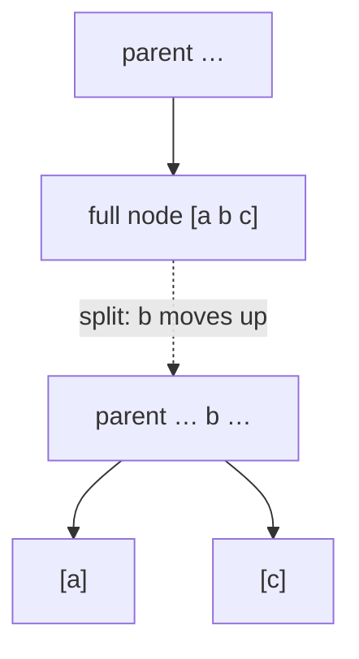

# 2-3-4 Trees

## What it is
A **2-3-4 tree** is a [B-tree](#/b_tree) with minimum degree `t = 2`: every node holds 1, 2 or 3 keys (so 2, 3 or 4 children) and all leaves are at the same depth. Problem 18-2 asks for two operations that cut and glue such trees in logarithmic time: **JOIN(T′, x, T″)**, which merges two trees whose keys all lie below and above a key `x`, and **SPLIT(T, x)**, which divides one tree into the keys smaller and larger than `x`. (2-3-4 trees are also the model behind [red-black trees](#/red_black_tree): a black node with its red children is one 2-, 3- or 4-node.)

## How it works
**Top-down insertion in a single pass.** Walk from the root toward the leaf where the new key belongs. Whenever the node about to be entered is **full** (3 keys), split it first: its middle key moves up into the parent (which is guaranteed to have room, because we split full nodes on the way down) and the other two keys form two separate 1-key nodes. Finally the key goes into a leaf with at most 2 keys. Because splits are made before descending, no upward propagation (and no second pass) is ever needed. The tree grows in height only when the **root** is split.

**JOIN.** Store (or compute) heights. If the heights are equal, make a new root with the single key `x` and the two roots as children. Otherwise walk down the boundary spine of the *taller* tree (right spine if it is the left tree) to the node whose children have the height of the shorter tree, hang `x` and the shorter tree there, and split any node that becomes overfull (4 keys) on the way back up. Because every non-root node of a 2-3-4 tree only needs at least one key, the root of the shorter tree is always a legal child. Cost `O(|h′ − h″| + 1)`.

**SPLIT.** Descend along the search path for `x`. At every node the children to the left of the path and their separator keys form a forest of trees of strictly increasing heights; JOIN them from the path outward to build the tree of smaller keys, and symmetrically the tree of larger keys. The joins cost `O(h_i − h_{i−1} + 1)` each and the heights telescope: `O(lg n)` in total.

## Complexity
`O(lg n)` for search, insert, **JOIN** and **SPLIT**; height between `⌈log₄(n+1)⌉` and `⌈lg(n+1)⌉`. Splits cost `O(1)` each and at most `lg n` happen per insertion; amortised over a sequence of insertions the number of splits is `O(1)` per insertion.

## When to use it
Mainly as a teaching device and as the model of red-black and left-leaning red-black trees; in practice the B-tree with a large branching factor (disk pages) is what is deployed.

## In this implementation
Keys are distinct `i64`s; `len()` counts by traversal. `join` and `split` take trees by value. `validate` checks key counts, ordering, child counts and equal leaf depth. Tests compare the tree with `BTreeSet` on 100 random insertion sequences (including repeated keys) check logarithmic height for 5 000 sorted insertions, compare `split` and `join` with sorted vectors on 200 random trees (every piece must stay a valid 2-3-4 tree), and join trees of very different heights.
