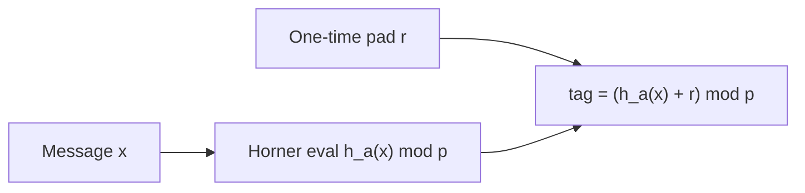

# k-Universal Hashing and Carter–Wegman Authentication

## What it is
A hash family $\mathcal{H} = \{h : U \to \{0,\dots,m-1\}\}$ is **$k$-universal** ($k$-wise independent) if for any $k$ distinct keys $x_1,\dots,x_k$ and any outputs $y_1,\dots,y_k$, a uniformly chosen $h \in \mathcal{H}$ satisfies
$$\Pr_{h}\bigl[h(x_1)=y_1 \wedge \dots \wedge h(x_k)=y_k\bigr] = \frac{1}{m^k}.$$
Extending [universal hashing](#/hash_functions), this construction builds arbitrary $k$-universal families via degree-$(k-1)$ polynomials over $\mathrm{GF}(p)$ and applies 2-universality to **Carter–Wegman one-time message authentication**.

## How it works
* **Polynomial evaluation (`PolyHash`)**: Pick prime $p \ge |U|$ and coefficients $a_0,\dots,a_{k-1} \in \mathbb{Z}_p$ uniformly at random. Evaluate $h_a(x) = \bigl(\sum_{j=0}^{k-1} a_j x^j\bigr) \bmod p$ via Horner's rule using `u128` modular arithmetic to eliminate overflow. Because a nonzero polynomial of degree $k-1$ over a field is uniquely determined by $k$ evaluation points (Lagrange interpolation), all $p^k$ tuples $(h_a(x_1),\dots,h_a(x_k))$ occur with identical probability $1/p^k$.
* **Carter–Wegman MAC (`cw_authenticate`, `cw_verify`)**: Given a secret strongly 2-universal key $h_a$ and a per-message secret pad $r \in \mathbb{Z}_p$, emit `(tag = (h_a(m) + r) mod p)`. Even after seeing $(m_1, \text{tag}_1)$, any distinct message $m_2$'s tag remains uniformly distributed over $\mathbb{Z}_p$.

## Complexity
* **Key size & evaluation**: $O(k)$ words of storage and $O(k)$ modular multiplications/additions per hash.
* **MAC tag & verification**: $O(1)$ for fixed $k = 2$.

## When to use it
Use degree-$(k-1)$ polynomial hashing whenever randomized data structures require stronger than pairwise independence (e.g. $5$-independent linear probing or count-sketch moments), and Carter–Wegman tags when authenticating messages under shared one-time pads.

## In this implementation
`PolyHash`, `strongly_2_universal`, `cw_authenticate`, and `cw_verify` verify exact $1/p^2$ joint uniformity across every pair $(x,y)$ over $\mathrm{GF}(11)$, exact $1/p^3$ 3-wise independence over $\mathrm{GF}(5)$, and information-theoretic tag unpredictability on tampered messages.
