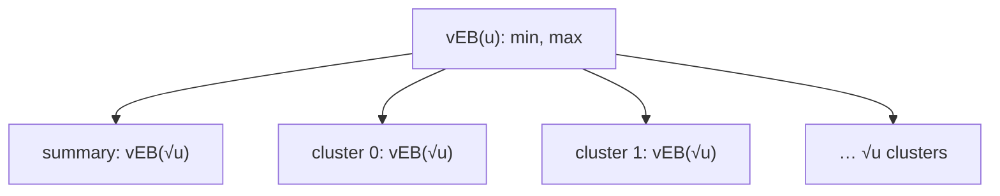

# van Emde Boas Trees

## What it is
A **van Emde Boas (vEB) tree** maintains a dynamic subset of the integer universe `{0, …, u−1}` and supports `INSERT`, `DELETE`, `MEMBER`, `MINIMUM`, `MAXIMUM`, `SUCCESSOR` and `PREDECESSOR` in **O(lg lg u)** time — exponentially faster than the Θ(lg n) of balanced trees when `u` is polynomial in `n`. It appears as Chapter 20 of the 3rd edition only (it was dropped from the 4th).

## How it works
Split every `lg u`-bit key into a **high half** (`⌊x/√u⌋`, selects a cluster) and a **low half** (`x mod √u`, position inside the cluster). A vEB(u) structure contains
* `√u` recursive vEB(√u) **clusters**,
* one vEB(√u) **summary** recording which clusters are non-empty,
* explicit `min` and `max` — and the minimum is *not* stored in a cluster, so inserting into an empty tree and deleting the last element are O(1).

The trick that gives `T(u) = T(√u) + O(1) = O(lg lg u)` is that every operation makes **only one** non-trivial recursive call: either into a cluster or into the summary, never both. `SUCCESSOR(x)` first checks whether `x`'s cluster has a larger element (recurse in the cluster); otherwise it asks the summary for the next non-empty cluster and returns that cluster's minimum (O(1)).

## Complexity
O(lg lg u) per operation; space Θ(u) as presented here (can be reduced to O(n) with hashing).

## When to use it
Integer priority queues with a bounded universe — e.g. IP routing, event simulation with integer timestamps, and as the building block for faster shortest-path algorithms on integer weights.

## In this implementation
Universe sizes need only be a power of two (high/low split uses `⌊lg u/2⌋` low bits, like the book's `√u` rounding). Randomised tests compare all seven operations with `BTreeSet` for universes from 2² to 2¹⁰.
