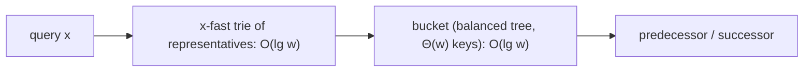

# x-Fast and y-Fast Tries

## What it is
A [van Emde Boas tree](#/van_emde_boas_tree) answers predecessor and successor queries over a universe of size `u` in `O(lg lg u)` time, but uses `Θ(u)` space. Problem 20-2 asks you to design the **y-fast trie** of Willard (1983), which keeps the `O(lg lg u)` query time but needs only `O(n)` space for `n` stored keys. It is built in two steps from the **x-fast trie**.

## How it works
**x-fast trie.** View each `w`-bit key (`w = lg u`) as a root-to-leaf path in a binary trie. For every depth `d = 0…w` keep a **hash table** of the length-`d` prefixes of the stored keys, each entry remembering the minimum and maximum key below it; also keep the sorted keys in a doubly linked list. To find the predecessor of `x`: because "the length-`d` prefix of `x` is in the trie" is monotone in `d`, **binary search on `d`** finds the longest stored prefix in `O(lg w) = O(lg lg u)` hash lookups. The node it ends at lacks the child on `x`'s side; the opposite child's minimum or maximum (plus the linked list) gives the predecessor and successor. Insertion and deletion touch all `w` levels: `O(w)`; space `O(n w)`.

**y-fast trie.** Partition the sorted keys into buckets of `Θ(w)` consecutive keys stored in balanced search trees (`O(lg w) = O(lg lg u)` per operation inside a bucket). Put **one representative per bucket** in an x-fast trie: only `n/w` keys, so its `O(w)` space per key adds up to `O(n)`. A query asks the x-fast trie for the right bucket, then the bucket for the answer; insertions and deletions split a bucket that grows beyond `2w` and merge one that shrinks below `w/2`, so their *amortised* cost is `O(lg lg u)`.

## Complexity
| structure | query | insert/delete | space |
|---|---|---|---|
| van Emde Boas | `O(lg lg u)` | `O(lg lg u)` | `Θ(u)` |
| x-fast trie | `O(lg lg u)` | `O(lg u)` | `O(n lg u)` |
| y-fast trie | `O(lg lg u)` | `O(lg lg u)` amortised | `O(n)` |

## When to use it
Integer predecessor search over large universes (IP routing tables, timestamps, 32/64-bit keys) when memory matters; it is the classic bridge between van Emde Boas trees and practical hashing-based structures.

## In this implementation
Keys are up to 31 bits. The x-fast trie supports insert, delete and both neighbour queries; the y-fast trie uses `BTreeSet` buckets with split at `2w` and merge below `w/2`. Tests compare both with `BTreeSet` on thousands of random inserts, deletes and queries (including delete-heavy workloads), check that bucket sizes never exceed `2w`, and show the space gap: the x-fast trie stores more than `8n` entries for 5 000 24-bit keys while the y-fast trie stays below `3n`.
