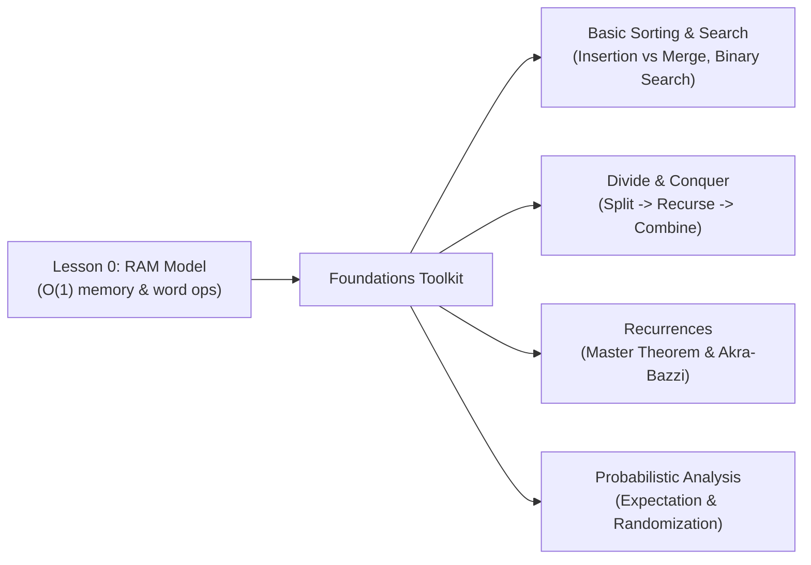

# Foundations

## Introduction
Before tackling specialized graph algorithms, trees, or cryptography, *Introduction to Algorithms* (Part I) teaches the **core toolkit every computer scientist uses to design and analyze algorithms**. Big-$O$ complexity does not exist in a vacuum — it depends directly on the **abstract computer architecture** assumed when counting steps. That is why CLRS explicitly defines the **Random-Access Machine (RAM) model** in Chapter 2 (§2.2, *Analyzing algorithms*) before proving bounds on any sort or search.

Treat **computational models and cost assumptions as Lesson 0**, right before [Insertion Sort](#/insertion_sort).

## Lesson 0: What Computer Does CLRS Assume?
The standard sequential **RAM model** is an idealized von Neumann-style machine designed so we can study algorithmic scaling independently of any specific x86 or ARM microarchitecture ([Computational Models & the RAM Model](#/ram_model)):

| Architectural Property | CLRS RAM Assumption |
|---|---|
| **Processor** | One processor executing instructions **sequentially** |
| **Memory** | Flat random-access array of words |
| **Memory latency** | Every access costs **$O(1)$** |
| **Arithmetic** | Basic operations on machine words cost **$O(1)$** |
| **Word size** | Large enough to address input elements, typically $O(\lg n)$ bits |
| **Instructions** | Basic arithmetic, comparisons, branches, `load`, `store` |
| **Cache hierarchy** | **Ignored** |
| **Instruction pipeline** | **Ignored** |
| **Multicore execution** | **Ignored** in sequential chapters |
| **SIMD / GPU** | **Ignored** in the basic model |

### Why Assumptions Matter: Array vs. Linked List
Traversing $n$ elements in a contiguous array versus a linked list both cost **$O(n)$** in the RAM model. On real hardware, the contiguous array can be an order of magnitude faster thanks to **spatial cache locality**, **hardware prefetching**, and the absence of serialized **pointer chasing**. Same Big-$O$, very different wall-clock speed!

To connect CLRS math with real systems, distinguish three layers of cost for every major algorithm:
1. **Algorithmic complexity:** asymptotic bounds such as $O(n)$, $\Theta(n \lg n)$, or $O(V + E)$.
2. **Machine cost:** instruction counts, memory reads/writes, and bit-level operations.
3. **Hardware cost:** cache misses, memory bandwidth, multicore parallelism, latency, energy, and silicon area.

## What Problem Is It Solving?
Across Foundations, there are five core pillars:

0. **Choosing a machine model & counting primitive costs (Lesson 0)** — Specify what operations cost $O(1)$ and when hardware realities diverge from sequential RAM ([RAM Model & Cache/Bit Cost Comparison](#/ram_model)).
1. **Ordering and searching small/basic arrays** — Given $n$ numbers, sort them or find a target value ([Insertion Sort](#/insertion_sort), [Selection Sort](#/selection_sort), [Bubble Sort](#/bubble_sort), [Merge Sort](#/merge_sort), [Linear Search](#/linear_search), [Binary Search](#/binary_search)).
2. **Breaking big problems into smaller ones (Divide-and-Conquer)** — Solve problems faster by splitting inputs into subproblems, solving recursively, and combining results ([Strassen's Algorithm](#/strassen), [Maximum Subarray](#/max_subarray), [Counting Inversions](#/inversions), [Monge Arrays](#/monge_arrays), [Chip Testing](#/chip_testing)).
3. **Solving recurrence relations** — Turning recursive pseudocode like $T(n) = 2T(n/2) + \Theta(n)$ into a closed-form Big-$\Theta$ bound ([Master Theorem](#/master_theorem), [Akra–Bazzi Method](#/akra_bazzi)).
4. **Analyzing randomized & online decisions** — Predicting expected running time or optimal stopping rules when inputs arrive in random order ([Hiring Problem](#/hire_assistant), [Random Permutations](#/random_permutation), [Online Hiring](#/online_hiring), [Probabilistic Counting](#/probabilistic_counting)).

## Other Computational Models in CS & CLRS
When cache misses, giant integers, disks, or parallel cores dominate runtime, CLRS and systems theory refine the machine model:

| Model | What It Adds or Changes | Where in This Repo |
|---|---|---|
| **RAM / Word-RAM** | $O(1)$ access & $w$-bit integer word operations | [RAM Model](#/ram_model), [Radix Sort](#/radix_sort), [van Emde Boas](#/van_emde_boas_tree) |
| **Bit complexity** | Costs individual bit operations when numbers outgrow words | [RAM Model](#/ram_model), [Modular Exponentiation](#/modular_exponentiation), [RSA](#/rsa) |
| **External-memory / I/O** | Counts $B$-sized block transfers between RAM and storage | [B-Trees](#/b_tree) |
| **Cache-aware / cache-oblivious** | Models L1/L2/L3 cache line transfers | [Matrix Multiply](#/matrix_multiply), [Strassen](#/strassen) |
| **PRAM (1st ed.)** | Many synchronous processors sharing memory | [PRAM Overview](#/topic/pram): [Parallel Prefix](#/parallel_prefix), [CRCW Max](#/crcw_maximum) |
| **Work–span (3e–4e)** | Total work $T_1$ and critical-path span $T_\infty$ | [Parallel Overview](#/topic/parallel): [Brent's Theorem](#/brent_scheduling), [P-Merge Sort](#/p_merge_sort) |
| **GPU / SIMT** | Vector lanes, warp divergence, memory coalescing | Related to [P-Scan & Stencil](#/p_scan_stencil_lu) |
| **Circuit model** | Logic gates, circuit depth (delay), and hardware area | [Circuits Overview](#/topic/circuits): [Carry-Lookahead Adder](#/carry_lookahead_adder), [Multipliers](#/multiplier_circuits) |

## Algorithms & Trade-Offs

| Technique / Algorithm | Typical Runtime | Extra Space | Core Trade-Off |
|---|---|---|---|
| [RAM Model & Traversal Profiler](#/ram_model) (Lesson 0) | Exact step counts; $O(n)$ array vs. list | $O(1)$ / Cache-line $B$ | Establishes baseline CLRS §2.2 cost rules while showing how cache misses and growing bit-widths cause identical Big-$O$ bounds to diverge on real CPUs. |
| [Insertion Sort](#/insertion_sort) / [Selection Sort](#/selection_sort) / [Bubble Sort](#/bubble_sort) | $\Theta(n^2)$ worst case; Insertion is $\Theta(n)$ if nearly sorted | $O(1)$ in-place | Tiny constant factors and super simple; beats asymptotically faster sorts for small $n$ (say $n \le 32$), which is why [Insertion/Merge Hybrid](#/insertion_merge_hybrids) switches at a cutoff. |
| [Merge Sort](#/merge_sort) | $\Theta(n \lg n)$ always | $\Theta(n)$ auxiliary array | Rock-solid worst-case scaling and stable, at the cost of extra memory allocation. Also adapts cleanly to [Counting Inversions](#/inversions). |
| [Linear Search](#/linear_search) vs. [Binary Search](#/binary_search) | $\Theta(n)$ vs. $\Theta(\lg n)$ | $O(1)$ | Binary search is exponentially faster, **but** requires sorted random-access data; linear search works on any unsorted sequence. |
| [Naive Matrix Multiply](#/matrix_multiply) vs. [Strassen's Algorithm](#/strassen) | $\Theta(n^3)$ vs. $\Theta(n^{\lg 7}) \approx \Theta(n^{2.81})$ | Strassen needs extra submatrix buffers | Strassen reduces asymptotic multiplications from 8 to 7 per level, **but** has higher constant factors and worse numerical stability/cache overhead for small matrices. |
| [Master Theorem](#/master_theorem) vs. [Akra–Bazzi](#/akra_bazzi) | — | — | Master Theorem gives instant formulas for equal-sized splits $aT(n/b) + f(n)$; Akra–Bazzi (4th ed.) handles messy **unequal** splits like $T(n/3) + T(2n/3) + n$. |
| [Hiring Problem](#/hire_assistant) / [Online Hiring](#/online_hiring) | $\Theta(n)$ steps | $O(1)$ | Randomizing order keeps expected hires at $\Theta(\ln n)$. Without knowing future candidates ([Online Hiring](#/online_hiring)), sampling the first $n/e$ candidates gives a $1/e \approx 36.8\%$ chance of picking the best overall. |

## Quick Rules of Thumb for CS Students
- **State the machine model before quoting Big-$O$:** $O(n)$ in the RAM model assumes $O(\lg n)$-bit words and uniform $O(1)$ memory — both assumptions break on giant integers ([RSA](#/rsa)) or pointer-heavy structures on cold caches.
- **Asymptotics aren't everything at small $n$:** Even standard library sorts (like Timsort or Introsort) drop into [Insertion Sort](#/insertion_sort) on small subarrays because $c_1 n^2$ beats $c_2 n \lg n$ when $n$ is tiny.
- **Equal vs. unequal recursion:** Reach for the [Master Theorem](#/master_theorem) first on exams; use [Akra–Bazzi](#/akra_bazzi) whenever the split sizes are uneven.
- **Worst-case vs. average-case:** Notice how [Random Permutations](#/random_permutation) turns an adversary's worst-case input into an expected-case guarantee without relying on assumptions about real-world data.
