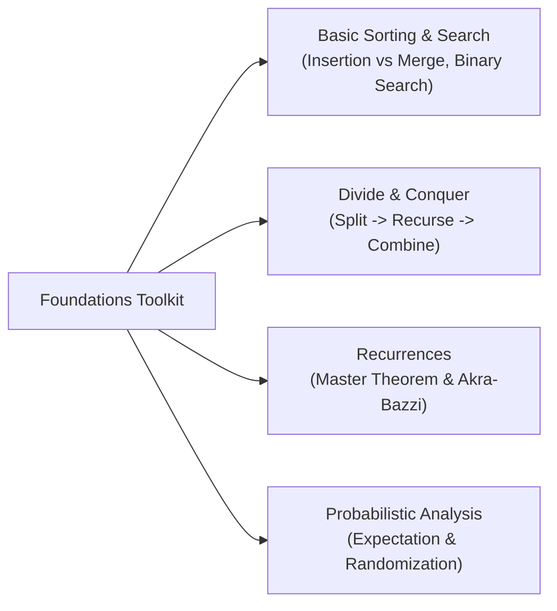

# Foundations

## Introduction
Before tackling specialized graph algorithms, trees, or cryptography, *Introduction to Algorithms* (Part I) teaches the **core toolkit every computer scientist uses to design and analyze algorithms**. If you are taking your first Algorithms & Data Structures course, this section is where you learn how to prove an algorithm is correct (loop invariants), figure out how fast it scales as input size $n$ grows (recurrences and asymptotics), and reason about algorithms that flip coins to get fast performance on average.

## What Problem Is It Solving?
Across this topic, there are four fundamental problems:

1. **Ordering and searching small/basic arrays** — Given $n$ numbers, sort them or find a target value ([Insertion Sort](#/insertion_sort), [Selection Sort](#/selection_sort), [Bubble Sort](#/bubble_sort), [Merge Sort](#/merge_sort), [Linear Search](#/linear_search), [Binary Search](#/binary_search)).
2. **Breaking big problems into smaller ones (Divide-and-Conquer)** — Solve problems faster by splitting inputs into subproblems, solving recursively, and combining results ([Strassen's Algorithm](#/strassen), [Maximum Subarray](#/max_subarray), [Counting Inversions](#/inversions), [Monge Arrays](#/monge_arrays), [Chip Testing](#/chip_testing)).
3. **Solving recurrence relations** — Turning recursive pseudocode like $T(n) = 2T(n/2) + \Theta(n)$ into a closed-form Big-$\Theta$ bound ([Master Theorem](#/master_theorem), [Akra–Bazzi Method](#/akra_bazzi)).
4. **Analyzing randomized & online decisions** — Predicting expected running time or optimal stopping rules when inputs arrive in random order ([Hiring Problem](#/hire_assistant), [Random Permutations](#/random_permutation), [Online Hiring](#/online_hiring), [Probabilistic Counting](#/probabilistic_counting)).

## Algorithms & Trade-Offs

| Technique / Algorithm | Typical Runtime | Extra Space | Core Trade-Off |
|---|---|---|---|
| [Insertion Sort](#/insertion_sort) / [Selection Sort](#/selection_sort) / [Bubble Sort](#/bubble_sort) | $\Theta(n^2)$ worst case; Insertion is $\Theta(n)$ if nearly sorted | $O(1)$ in-place | Tiny constant factors and super simple; beats asymptotically faster sorts for small $n$ (say $n \le 32$), which is why [Insertion/Merge Hybrid](#/insertion_merge_hybrids) switches at a cutoff. |
| [Merge Sort](#/merge_sort) | $\Theta(n \lg n)$ always | $\Theta(n)$ auxiliary array | Rock-solid worst-case scaling and stable, at the cost of extra memory allocation. Also adapts cleanly to [Counting Inversions](#/inversions). |
| [Linear Search](#/linear_search) vs. [Binary Search](#/binary_search) | $\Theta(n)$ vs. $\Theta(\lg n)$ | $O(1)$ | Binary search is exponentially faster, **but** requires sorted random-access data; linear search works on any unsorted sequence. |
| [Naive Matrix Multiply](#/matrix_multiply) vs. [Strassen's Algorithm](#/strassen) | $\Theta(n^3)$ vs. $\Theta(n^{\lg 7}) \approx \Theta(n^{2.81})$ | Strassen needs extra submatrix buffers | Strassen reduces asymptotic multiplications from 8 to 7 per level, **but** has higher constant factors and worse numerical stability/cache overhead for small matrices. |
| [Master Theorem](#/master_theorem) vs. [Akra–Bazzi](#/akra_bazzi) | — | — | Master Theorem gives instant formulas for equal-sized splits $aT(n/b) + f(n)$; Akra–Bazzi (4th ed.) handles messy **unequal** splits like $T(n/3) + T(2n/3) + n$. |
| [Hiring Problem](#/hire_assistant) / [Online Hiring](#/online_hiring) | $\Theta(n)$ steps | $O(1)$ | Randomizing order keeps expected hires at $\Theta(\ln n)$. Without knowing future candidates ([Online Hiring](#/online_hiring)), sampling the first $n/e$ candidates gives a $1/e \approx 36.8\%$ chance of picking the best overall. |

## Quick Rules of Thumb for CS Students
- **Asymptotics aren't everything at small $n$:** Even standard library sorts (like Timsort or Introsort) drop into [Insertion Sort](#/insertion_sort) on small subarrays because $c_1 n^2$ beats $c_2 n \lg n$ when $n$ is tiny.
- **Equal vs. unequal recursion:** Reach for the [Master Theorem](#/master_theorem) first on exams; use [Akra–Bazzi](#/akra_bazzi) whenever the split sizes are uneven.
- **Worst-case vs. average-case:** Notice how [Random Permutations](#/random_permutation) turns an adversary's worst-case input into an expected-case guarantee without relying on assumptions about real-world data.
