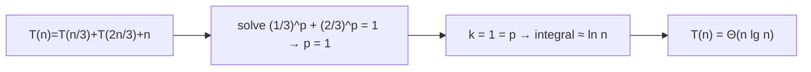

# Akra–Bazzi Recurrence Method

## What it is
The [master theorem](#/master_theorem) only handles subproblems of equal size. The **Akra–Bazzi method**, added in the 4th edition (Section 4.7), solves general divide-and-conquer recurrences

`T(n) = g(n) + Σᵢ aᵢ · T(bᵢ n)`  with `aᵢ > 0`, `0 < bᵢ < 1`.

## How it works
1. Find the unique real `p` with `Σᵢ aᵢ · bᵢ^p = 1`.
2. Then `T(n) = Θ( n^p · (1 + ∫₁ⁿ g(u)/u^(p+1) du) )`.

For `g(n) = n^k`: if `k < p` the result is `Θ(n^p)`, if `k = p` it is `Θ(n^p lg n)`, and if `k > p` it is `Θ(n^k)`.

## Complexity
Finding `p` is a one-dimensional root finding of a monotone function; the implementation bisects.

## When to use it
Recurrences from unbalanced partitioning (quicksort with a fixed split ratio, [select](#/select_linear_time) with groups of 5: `T(n) = T(n/5) + T(7n/10) + O(n)` ⇒ `Θ(n)`), or any recursion with different branch sizes.

## In this implementation
`find_p` bisects for `p`; `solve` reports the asymptotic class for `g(n) = n^k lg^q n`; `evaluate` computes the recurrence numerically so the claimed bound can be compared with reality.
