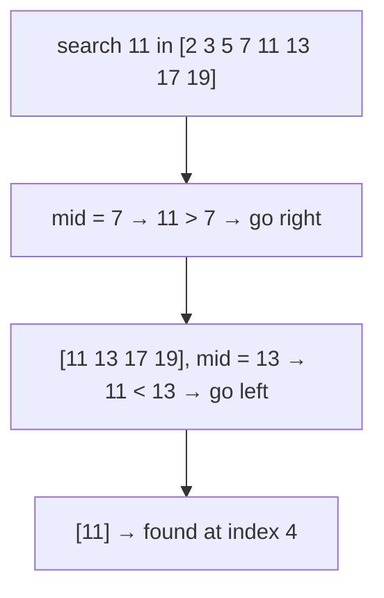

# Binary Search

## What it is
Searching a **sorted** array by repeatedly comparing the target with the middle element and discarding half of the remaining range. Exercise 2.3-5 asks for the pseudocode and a proof that it takes Θ(lg n) in the worst case; Exercise 2.3-7 combines sorting with a sweep to decide whether two elements sum to `x`.

## How it works

Recurrence: `T(n) = T(n/2) + Θ(1)`, i.e. `Θ(lg n)` by the [master theorem](#/master_theorem).

## Complexity
Θ(lg n) comparisons worst case, Θ(1) best case; O(1) space iteratively.

## When to use it
Any sorted, random-access collection; also on monotone predicates ("smallest x such that f(x) is true"). It is the engine behind the Θ(n lg n) two-sum test and many divide-and-conquer proofs.

## In this implementation
* `binary_search` (iterative, half-open interval, overflow-safe midpoint)
* `binary_search_rec` (recursive)
* `has_pair_with_sum` — Exercise 2.3-7, done with sort + two pointers.
