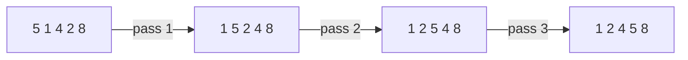

# Bubble Sort

## What it is
Problem 2-2 of CLRS asks you to prove that `BUBBLESORT` is correct (two loop invariants) and to compare its running time to insertion sort. Each pass "bubbles" the smallest remaining element to the front by swapping adjacent inverted pairs.

## How it works

Invariant of the inner loop: `A[j]` is the smallest element of `A[j..n]`. Invariant of the outer loop: `A[1..i]` is sorted and contains the `i` smallest elements.

## Complexity
Θ(n²) comparisons; swaps equal the number of [inversions](#/inversions). The book's point: its worst case matches insertion sort, but it does more swaps in practice.

## When to use it
Almost never in practice — it is a teaching algorithm. The early-exit version is Θ(n) on sorted data.

## In this implementation
`bubble_sort` follows the pseudocode; `bubble_sort_early_exit` returns the number of passes performed.
