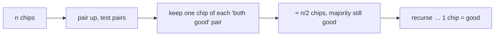

# Chip Testing

## What it is
Professor Diogenes has `n` supposedly identical VLSI chips, some good and some bad. Two chips can test each other: a good chip always reports the other chip's status truthfully; a **bad chip may say anything**. Problem 4-5 asks how to find a good chip when more than half the chips are good — a classic divide-and-conquer/majority argument.

## How it works
A **pairwise test** gives one of: both say "good" → *both good or both bad*; any other outcome → *at least one is bad*.
1. Pair up the chips and test each pair. **Discard** every pair that does not report "both good"; from each remaining pair keep **one** chip.
2. The kept chips still have a **strict majority of good ones** (Lemma: discarded pairs contain at least as many bad chips as good ones; kept pairs are both-good or both-bad).
3. Recurse on the survivors (about half as many). `T(n) ≤ T(⌈n/2⌉) + ⌊n/2⌋ = O(n)`.
4. **Odd `n`:** set one chip aside and test it against all others — a good chip is endorsed by at least `(n−1)/2` others, a bad one by fewer — so either the leftover is good, or it can be dropped while the majority remains strict.
Once one good chip is known, `n−1` further tests classify all the others.

## Complexity
Θ(n) pairwise tests (here ≤ 3n including the odd-n steps) — the same recurrence as [selection in linear time](#/select_linear_time).

## When to use it
A model for fault diagnosis with unreliable testers (Byzantine-style majority arguments), voting and consensus protocols.

## In this implementation
Bad chips are simulated with three adversarial policies (random, always "good", always "bad"); tests run 400 random populations and assert correctness and the linear test bound.
