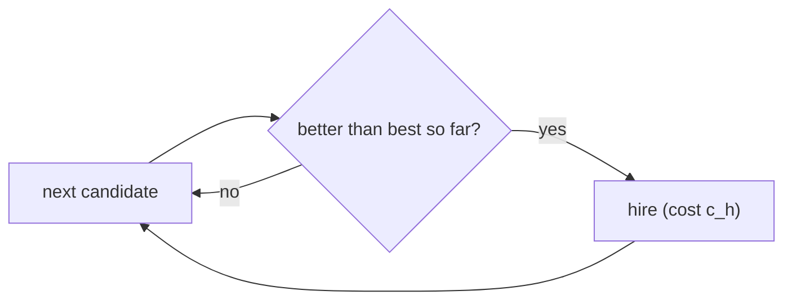

# Hiring Problem & Indicator Variables

## What it is
The hiring problem is CLRS's vehicle for **probabilistic analysis**. You interview `n` candidates one at a time and hire any candidate better than the current best. Interviewing is cheap, hiring is expensive — what is the total hiring cost?

## How it works

Let `Xᵢ` be the indicator that candidate `i` is hired. Candidate `i` is the best of the first `i` with probability `1/i` if the order is uniformly random, so

`E[X] = Σ 1/i = H_n = ln n + O(1)`.

So the expected hiring cost is `O(c_h ln n)` rather than `O(c_h n)`. The worst case (candidates arriving in increasing quality) still hires everyone — randomising the input order, see [random permutation](#/random_permutation), turns the worst case into an expectation.

## Complexity
Time Θ(n) interview cost; expected hires Θ(ln n).

## When to use it
This is a technique more than a procedure: **linearity of expectation with indicator random variables** is used to analyse quicksort, hashing and skip-lists. The same "records in a random sequence" structure appears in the [online hiring problem](#/online_hiring).

## In this implementation
`hire_assistant` counts hires; `average_hires` Monte-Carlo-estimates the expectation and the tests check it against `H_n`.
