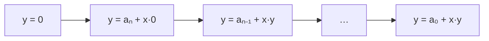

# Horner's Rule

## What it is
Problem 2-3 introduces **Horner's rule** for evaluating

`P(x) = a₀ + a₁x + a₂x² + … + aₙxⁿ`

by parenthesising it as `a₀ + x(a₁ + x(a₂ + … + x(aₙ₋₁ + x·aₙ)…))`. Each coefficient costs exactly one multiplication and one addition, so evaluation takes Θ(n) arithmetic operations — optimal in the general model.

## How it works

The problem asks you to prove the loop invariant: at the start of the iteration with index `i`, `y = Σₖ aₖ₊ᵢ₊₁ · xᵏ`.

The naive approach (`naive_eval`) recomputes each power and uses Θ(n²) multiplications; a running-power loop (`running_power_eval`) is Θ(n) but needs twice as many multiplications as Horner.

## Complexity
n multiplications, n additions; O(1) extra space.

## When to use it
Evaluating polynomials and hash functions (polynomial rolling hashes in [Rabin–Karp](#/rabin_karp)), base conversion, and as the sequential baseline for [FFT-based evaluation](#/fft_recursive).

## In this implementation
Integer coefficients with wrapping not applied — keep values small. Three evaluators are cross-checked in the tests.
