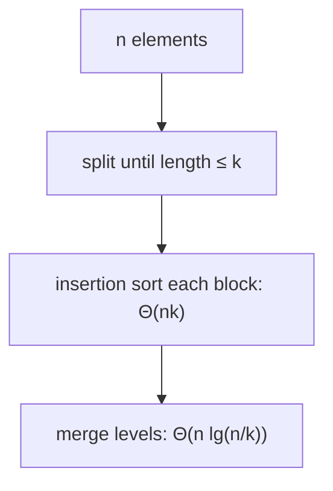

# Binary Insertion Sort & Insertion/Merge Hybrid

## What it is
Two small refinements of the Chapter 2 sorts. **Exercise 2.3-6** asks whether the insertion point in [insertion sort](#/insertion_sort) can be found with [binary search](#/binary_search). **Problem 2-1** asks how much faster [merge sort](#/merge_sort) gets if subarrays of length ≤ k are sorted by insertion sort instead of recursing down to single elements — the trick used by real library sorts such as Timsort.

## How it works
* **Binary insertion sort** locates where `A[j]` belongs in the sorted prefix with `⌈lg j⌉` comparisons, then shifts. Comparisons drop to `Θ(n lg n)`, but the shifting still costs `Θ(n²)` element moves, so the worst-case *time* stays `Θ(n²)`.
* **Hybrid:** the `n/k` sublists of length `k` cost `Θ(nk)` total with insertion sort; merging them takes `Θ(n lg(n/k))`. Total worst case `Θ(nk + n lg(n/k))`; the best `k` is `Θ(lg n)` in theory and ≈ 16–64 in practice because insertion sort has tiny constants.

## Complexity
Binary insertion: Θ(n lg n) comparisons, Θ(n²) moves. Hybrid: Θ(nk + n lg(n/k)).

## When to use it
Binary insertion is good when comparisons are expensive but moves are cheap. The hybrid is how production sorts get their speed on small runs.

## In this implementation
Both functions count comparisons; the demo tabulates counts for several cutoffs, and tests check correctness, stability and the `n lg n` comparison bound.
