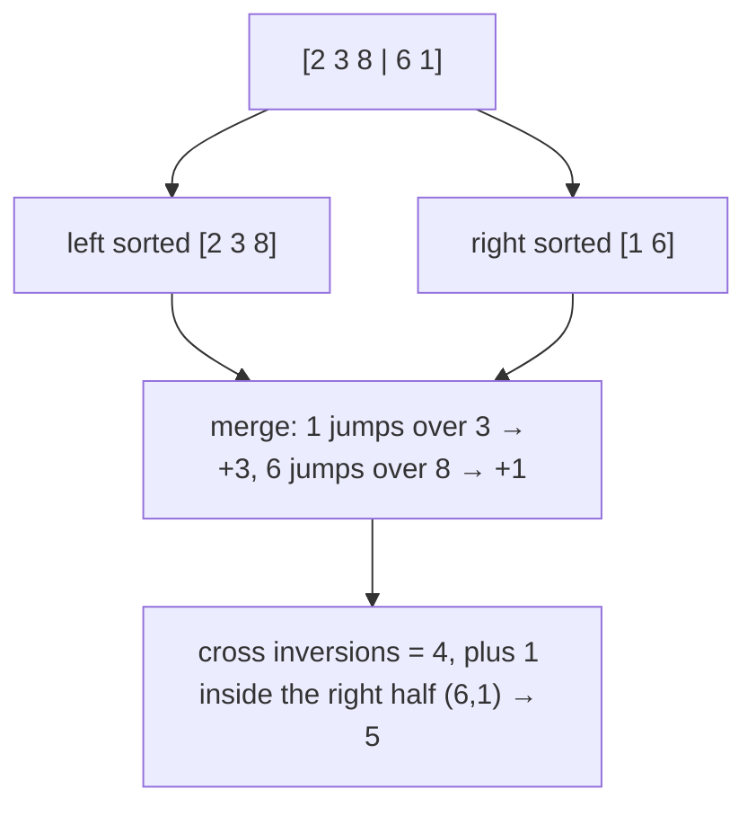

# Counting Inversions

## What it is
An **inversion** in `A` is a pair `i < j` with `A[i] > A[j]`. Problem 2-4 shows that the number of inversions measures how far an array is from sorted (it is exactly the number of swaps [bubble sort](#/bubble_sort) performs and governs [insertion sort](#/insertion_sort)'s running time). An array of distinct elements has at most n(n−1)/2 inversions.

## How it works
Modify [merge sort](#/merge_sort): during `MERGE`, whenever an element of the **right** half is placed before the remaining `m` elements of the **left** half, it forms `m` inversions with them. Summing over all merges counts every inversion exactly once.

## Complexity
Θ(n lg n) time, Θ(n) space (versus Θ(n²) brute force).

## When to use it
Measuring rank correlation (Kendall's τ distance), comparing two rankings (collaborative filtering), and analysing sorting algorithms.

## In this implementation
`count_inversions` (merge-sort based) is verified against `count_inversions_naive` on random inputs.
