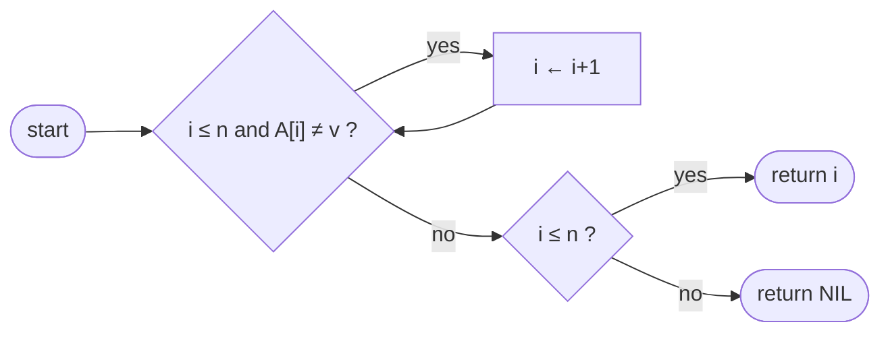

# Linear Search

## What it is
Given a sequence `A` and a value `v`, return an index `i` with `A[i] = v`, or `NIL` if none exists. Exercise 2.1-3 asks the reader to write the pseudocode and prove it correct with a **loop invariant** — it is the simplest non-trivial use of that proof technique.

## How it works
Scan left to right. Invariant: before each iteration, `v` does not occur in `A[1..i-1]`. If the loop ends without a hit the invariant gives "v is absent".

The **sentinel** variant temporarily appends `v` to the array so the bounds check can be dropped from the loop.

## Complexity
Θ(n) worst case, Θ(1) best case; on average about n/2 comparisons for a successful search. O(1) space.

## When to use it
Unsorted data, tiny arrays, or a one-off lookup where building an index would cost more than scanning. For sorted data use [binary search](#/binary_search).

## In this implementation
`linear_search` is generic over `PartialEq`; `sentinel_search` works on `Vec<i64>` and restores the vector before returning.
