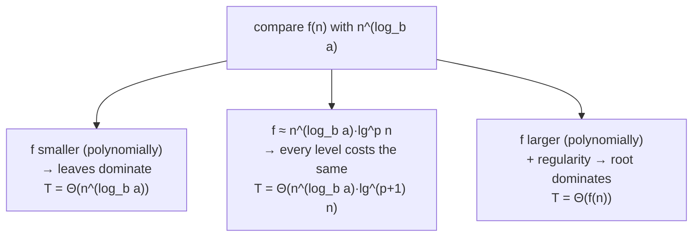

# Master Theorem

## What it is
A cookbook for divide-and-conquer recurrences `T(n) = a·T(n/b) + f(n)` with `a ≥ 1`, `b > 1`. You compare the **driving function** `f(n)` with the **watershed function** `n^(log_b a)`, which is the cost of the leaves of the recursion tree.

## How it works

| Case | Condition | Result |
|---|---|---|
| 1 | `f(n) = O(n^(log_b a − ε))` | `Θ(n^(log_b a))` |
| 2 | `f(n) = Θ(n^(log_b a) lg^k n)`, `k ≥ 0` | `Θ(n^(log_b a) lg^(k+1) n)` |
| 3 | `f(n) = Ω(n^(log_b a + ε))` and `a·f(n/b) ≤ c·f(n)` | `Θ(f(n))` |

The 4th edition (Section 4.5) states Case 2 for all real `k` (including `k = −1` giving `lg lg n`), which this implementation follows. Recurrences that do not fit (gaps between cases, unequal subproblem sizes) need the [Akra–Bazzi method](#/akra_bazzi) or a substitution proof.

## Complexity
Evaluating the theorem is O(1); the code also provides a numeric evaluator to sanity-check a result.

## When to use it
Analysing merge sort (`2T(n/2)+n → n lg n`), binary search (`T(n/2)+1 → lg n`), Strassen (`7T(n/2)+n² → n^2.81`), the recursive matrix multiply, and most textbook divide-and-conquer algorithms.

## In this implementation
`solve(a, b, k, p)` models `f(n) = n^k lg^p n` and returns the case with a printable bound; `evaluate` computes the recurrence exactly for comparison.
