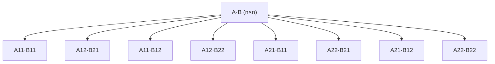

# Matrix Multiplication (Naive & Recursive)

## What it is
Multiplying two `n × n` matrices is the running example of Chapter 4's divide-and-conquer discussion (Chapter 28 in the first three editions). `C = A·B` has `cᵢⱼ = Σₖ aᵢₖ bₖⱼ`.

## How it works
**Definition (triple loop):** n² output entries, each a dot product of length n ⇒ Θ(n³).

**Recursive blocks:** partition each matrix into four `n/2 × n/2` quadrants:

```
| C11 C12 |   | A11 A12 |   | B11 B12 |
| C21 C22 | = | A21 A22 | · | B21 B22 |
```
with `C11 = A11·B11 + A12·B21` and similarly for the other three blocks — **8 recursive multiplications** plus Θ(n²) additions.


Recurrence `T(n) = 8T(n/2) + Θ(n²)` solves to Θ(n³) — no gain over the loop. [Strassen's algorithm](#/strassen) cuts the 8 multiplications to 7.

## Complexity
Θ(n³) time; the recursive version also copies blocks (Θ(n²) extra space per level in this implementation).

## When to use it
The triple loop is the right choice for small dense matrices. Divide-and-conquer structure matters for cache-oblivious layouts and parallelism ([parallel matrix multiply](#/p_matrix_multiply)).

## In this implementation
`Matrix = Vec<Vec<i64>>`; recursion requires `n` to be a power of two (as in the book). Tests cross-check both versions.
