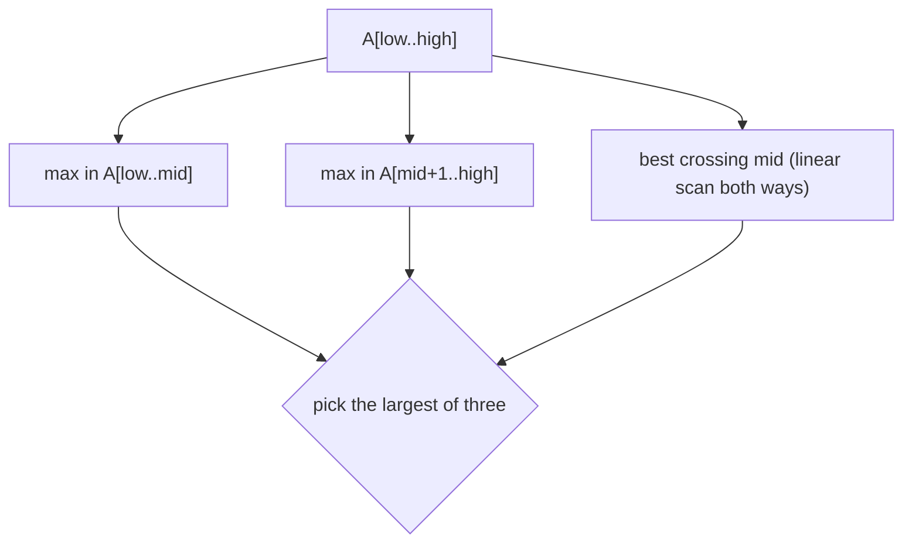

# Maximum Subarray

## What it is
Given an array of (possibly negative) numbers, find the **contiguous** subarray with the largest sum. CLRS motivates it with a stock-trading story: with daily price *changes*, the best buy/sell pair is the maximum subarray. The 3rd edition uses it (Section 4.1) as the first divide-and-conquer example beyond sorting; the 4th edition dropped the section but keeps the linear-time idea as Exercise 4.1-5.

## How it works
**Divide and conquer.** Split at the midpoint. The best subarray is entirely in the left half, entirely in the right half, or **crosses the midpoint**. The crossing case is solved in linear time by extending left from `mid` and right from `mid+1`, keeping the best running sums.

Recurrence `T(n) = 2T(n/2) + Θ(n)` ⇒ `Θ(n lg n)`.

**Linear scan (Kadane).** Track the best subarray ending at `j`: either extend it by `A[j]` or restart at `j`. Θ(n) time, O(1) space.

## Complexity
| Method | Time |
|---|---|
| Brute force | Θ(n²) |
| Divide & conquer | Θ(n lg n) |
| Scan / Kadane | Θ(n) |

## When to use it
Stock/price analysis, genomic segment scoring, image-processing "brightest rectangle" (2-D generalisation), and as a template for dynamic-programming over prefixes.

## In this implementation
`find_max_crossing_subarray`, `find_maximum_subarray` (the book's pseudocode), `kadane`, and a `brute_force` oracle used by the tests. Indices are inclusive.
