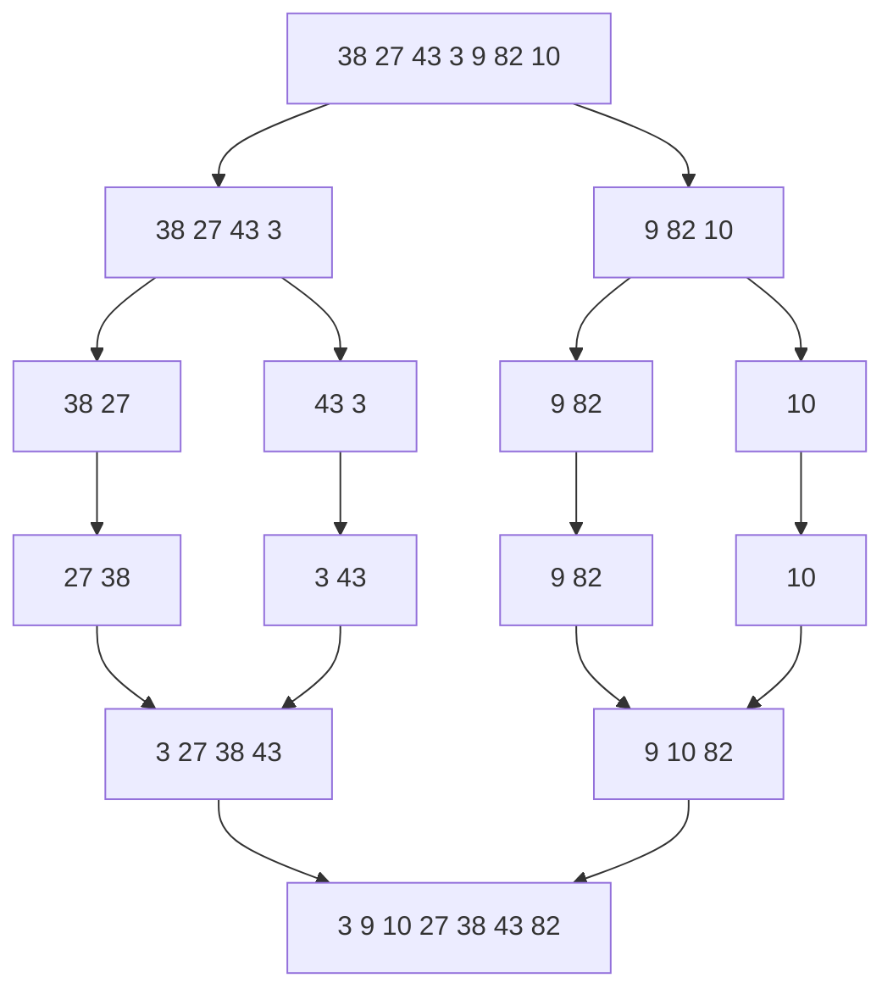

# Merge Sort

## What it is
Merge sort is the canonical **divide-and-conquer** algorithm and the book's first example of a recurrence. It guarantees Θ(n lg n) time on every input.

## How it works
1. **Divide** the array into two halves.
2. **Conquer** by sorting each half recursively (an array of one element is already sorted).
3. **Combine** with `MERGE`: repeatedly take the smaller front element of the two sorted halves — linear time.

The running time satisfies `T(n) = 2T(n/2) + Θ(n)`, which the [master theorem](#/master_theorem) solves to `Θ(n lg n)`.

## Complexity
Θ(n lg n) time in all cases; Θ(n) auxiliary space; stable.

## When to use it
* Guaranteed worst-case bounds and stability (e.g. sorting records by several keys).
* External sorting and linked lists, where sequential access matters.
* It underlies [counting inversions](#/inversions) and [parallel merge sort](#/p_merge_sort).

## In this implementation
`merge` implements MERGE(A,p,q,r) with auxiliary vectors (the 3rd/4th-edition style, without sentinels). `merge_sort` is the recursive version, `merge_sort_bottom_up` the iterative one from Section 2.3's discussion.
