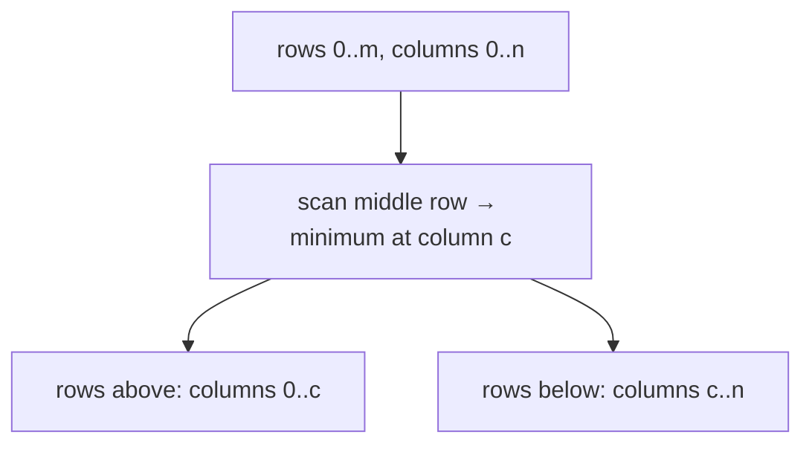

# Monge Arrays

## What it is
An `m × n` array `A` is **Monge** if for all `i < k` and `j < l`: `A[i,j] + A[k,l] ≤ A[i,l] + A[k,j]`. Equivalently every adjacent 2×2 block satisfies the inequality. Monge arrays arise in geometry and dynamic programming (distance arrays, optimal-transport costs). Problem 4-6 develops an algorithm for their row minima as a divide-and-conquer exercise.

## How it works
**Key lemma:** let `f(i)` be the column of the leftmost minimum in row `i`. Then `f(1) ≤ f(2) ≤ … ≤ f(m)` — the minima move monotonically rightwards.

1. Solve the **middle row** `m/2` by scanning its allowed column range (`O(n)`).
2. Recurse on the rows above, restricted to columns `≤ f(mid)`, and on the rows below, restricted to columns `≥ f(mid)`.

Each level of recursion scans in total `O(n + m)` entries (ranges overlap only at the split columns), and there are `lg m` levels: `T(m, n) = O(m + n lg m)`. (The SMAWK algorithm refines this to `O(m + n)`.)

## Complexity
`O(m + n lg m)` array accesses versus `Θ(mn)` brute force.

## When to use it
Speeding up dynamic programs with the Monge/quadrangle-inequality property (the optimisation of [optimal BST](#/optimal_bst) by Knuth is of this kind), nearest-neighbour searches in sorted point sets, and line-breaking problems like [printing neatly](#/printing_neatly).

## In this implementation
The array is accessed through an oracle `f(i, j)` so evaluation counts can be measured (the demo shows ≈ 11 000 evaluations for 10⁶ entries). Tests use random Monge arrays built from non-negative second differences.
