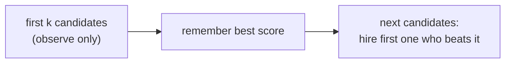

# Online Hiring (Secretary Problem)

## What it is
Section 5.4.4 considers a hiring decision that must be made **immediately** after each interview: you want to hire the single best of `n` candidates presented in random order and cannot go back. The strategy `ON-LINE-MAXIMUM(k, n)` is the classic **secretary problem** solution.

## How it works
1. Interview and **reject** the first `k` candidates; remember the best score `bestscore` seen.
2. Hire the first later candidate whose score exceeds `bestscore`.

The best candidate is hired when the best of all `n` appears after position `k` and the best of the first `i−1` lies in the first `k`. This gives probability `(k/n) Σ_{i=k+1}^{n} 1/(i−1) ≈ (k/n) ln(n/k)`, maximised at `k = n/e` with value **1/e ≈ 0.368**.

## Complexity
Θ(n) time, O(1) space. Success probability tends to `1/e`.

## When to use it
Any optimal-stopping decision with irrevocable choices: hiring, apartment hunting, selling an asset, choosing a parking spot. It prefigures the competitive analysis of [online algorithms](#/elevator).

## In this implementation
`online_maximum` returns the hired index; `success_rate` runs a Monte-Carlo experiment (the demo sweeps `k` and shows the peak near `n/e`).
