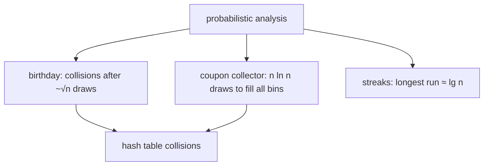

# Birthday Paradox, Balls & Bins, Streaks

## What it is
Section 5.4 applies probabilistic analysis to three problems that recur throughout hashing, load balancing and data-structure analysis.

## How it works
**Birthday paradox.** With `k` people and `n = 365` days, `P(no shared birthday) = Π_{i<k} (1 − i/n)`. It drops below ½ at only **k = 23**. The indicator-variable argument gives expected colliding pairs `C(k,2)/n`, so `k ≈ √(2n)` suffices for a collision.

**Balls and bins / coupon collector.** Toss balls into `n` bins until each bin is non-empty. Waiting for the `i`-th new bin takes `n/(n−i+1)` tosses on average, so the expected total is `n·H_n ≈ n ln n`.

**Streaks.** The longest run of heads in `n` fair flips is `Θ(lg n)` in expectation.

## Complexity
Closed-form formulas run in O(k); simulations are included to verify them.

## When to use it
Sizing hash tables ([chained hashing](#/chained_hash_table)), estimating how many random IDs can be generated before a collision, load balancing, cache analysis.

## In this implementation
Exact birthday probability, smallest even-odds group, Monte-Carlo balls-and-bins and streak experiments, all with a deterministic RNG so the run log is reproducible.
