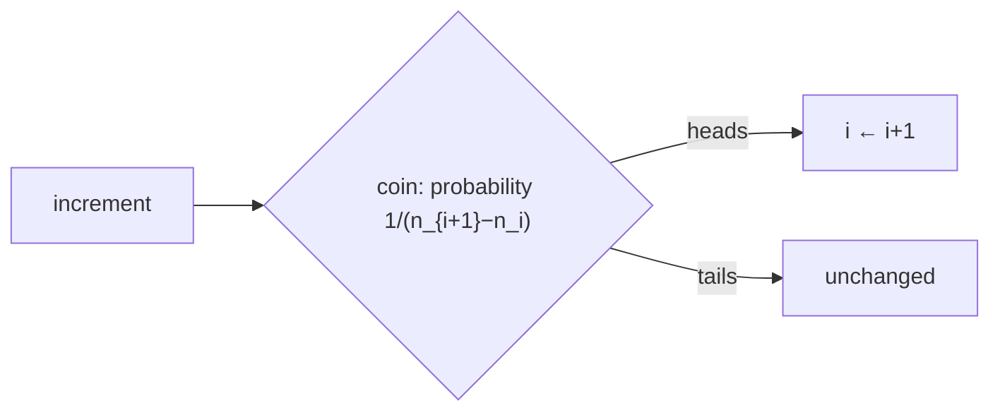

# Probabilistic Counting

## What it is
A `b`-bit counter normally counts only to `2ᵇ − 1`. Problem 5-1 shows how to count much further with a **randomised** counter that stores a small index `i` representing the value `nᵢ` — the idea of Robert Morris (1978), used for approximate event counting in network routers, databases and sketching.

## How it works
The counter holds `i` (initially 0). `INCREMENT` advances `i` to `i+1` with probability `1/(nᵢ₊₁ − nᵢ)` and otherwise does nothing. The estimate is `nᵢ`.

**Unbiased:** the expected increase of the estimate per call is `(nᵢ₊₁ − nᵢ)·1/(nᵢ₊₁ − nᵢ) = 1`, so `E[nᵢ] = n` after `n` increments (indicator variables and linearity of expectation).

**Variance** depends on the spacing: with `nᵢ = 100i` the variance after `n` increments is `99n` (standard deviation ≈ `10√n`). With `nᵢ = 2ⁱ − 1` (Morris's choice) the register needs only `lg lg n` bits but the variance is about `n²/2`.

## Complexity
`O(1)` time and `O(lg n)` or `O(lg lg n)` bits per counter.

## When to use it
Counting very many events in limited memory (packet counters, frequency sketches, HyperLogLog's cousin ideas), where a relative error of tens of percent is acceptable.

## In this implementation
`Counter::linear()` and `Counter::morris()`; tests confirm unbiasedness and the `99n` variance by simulation with fixed seeds, and that the Morris register stays under 25 after 10⁵ increments. Related analysis: [hiring problem](#/hire_assistant).
