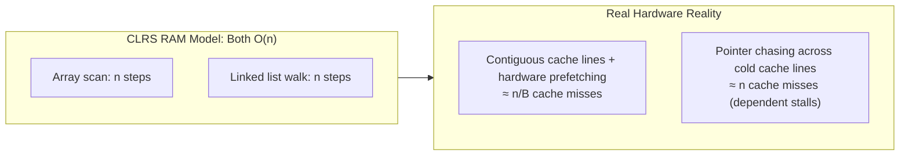

# Computational Models & the RAM Model (Lesson 0)

## What it is
Before analyzing [Insertion Sort](#/insertion_sort) or proving any Big-$O$ bound, **CLRS Chapter 2 (§2.2, *Analyzing algorithms*)** defines the abstract computer executing our pseudocode: the **Random-Access Machine (RAM)** model. Because Big-$O$ runtime depends on which operations cost $O(1)$ and what the hardware charges for memory, stating the machine model first is **Lesson 0** of algorithm analysis.

## What Computer Does CLRS Assume?
The standard sequential RAM model is closer to an idealized von Neumann machine than to an actual x86 or ARM microarchitecture:

| Architectural Property | CLRS RAM Assumption |
|---|---|
| **Processor** | One processor executing instructions **sequentially** (no concurrency) |
| **Memory** | Flat, random-access array of words |
| **Memory latency** | Every load/store costs **$O(1)$** (uniform access time) |
| **Arithmetic & logic** | Add, subtract, multiply, divide, remainder, shifts, and bitwise ops cost **$O(1)$** |
| **Word size** | Wide enough to address input elements, typically $w = \Theta(\lg n)$ bits |
| **Instructions** | Data movement (`load`, `store`, copy), arithmetic, comparisons, branches, calls/returns |
| **Cache hierarchy** | **Ignored** (L1/L2/L3 caches, TLB, DRAM row buffers absent) |
| **Instruction pipeline** | **Ignored** (no branch mispredictions or out-of-order hazards) |
| **Multicore execution** | **Ignored** in sequential analysis (revisited in parallel/PRAM chapters) |
| **SIMD / GPU** | **Ignored** (no vector lanes, warps, or divergence) |

This simplification lets us study algorithmic scaling independently of any specific CPU generation.

## Why These Assumptions Matter: Array vs. Linked List
Consider traversing $n$ elements stored either sequentially in an array or scattered across nodes in a linked list:

In the RAM model, both take $\Theta(n)$ time. On real silicon, contiguous array traversal streams sequential cache lines ($B$ elements per line) and hides latency with hardware prefetchers, while pointer chasing stalls on almost every node because the next address isn't known until the current DRAM load returns.

For bridging algorithms to real systems hardware, it helps to track **three distinct layers of cost**:
1. **Algorithmic complexity:** asymptotic growth like $O(n)$, $\Theta(n \lg n)$, or $O(V + E)$.
2. **Machine cost:** concrete instruction counts, memory loads/stores, and bit operations (like CLRS §2.2 line-by-line profiling of [Insertion Sort](#/insertion_sort) or [Bit Complexity](#/modular_exponentiation)).
3. **Hardware cost:** cache misses, memory bandwidth, thread parallelism, critical-path latency, energy, and silicon area.

## Other Computational Models in CS & CLRS
When sequential unit-cost RAM hides the true bottleneck, computer scientists switch to a richer model:

| Model | What It Adds or Changes | Covered in This Repo |
|---|---|---|
| **RAM / Word-RAM** | $O(1)$ memory access and $w$-bit integer operations | [Insertion Sort](#/insertion_sort), [Radix Sort](#/radix_sort), [van Emde Boas](#/van_emde_boas_tree) |
| **Bit Complexity** | Measures single-bit operations when integers grow past machine words | [Modular Exponentiation](#/modular_exponentiation), [RSA](#/rsa), [Karatsuba](#/karatsuba) |
| **External-Memory / I/O Model** | Counts block transfers ($B$ items/page) between fast RAM and disk | [B-Trees](#/b_tree) |
| **Cache-Aware / Cache-Oblivious** | Optimizes block transfers across L1/L2/L3 without hardcoding $B, M$ | [Matrix Multiplication](#/matrix_multiply), [Strassen](#/strassen) |
| **PRAM (1st ed.)** | Synchronous shared-memory processors executing in lockstep | [PRAM Overview](#/topic/pram): [Parallel Prefix](#/parallel_prefix), [CRCW Maximum](#/crcw_maximum) |
| **Work–Span / Fork–Join (3e–4e)** | Total work $T_1$ vs. critical-path span $T_\infty$ + scheduler bounds | [Parallel Overview](#/topic/parallel): [Brent's Theorem](#/brent_scheduling), [Parallel Merge Sort](#/p_merge_sort) |
| **GPU / SIMT** | Wide lockstep lanes, warp divergence penalties, coalesced memory | Related to [P-Scan / Stencil](#/p_scan_stencil_lu) |
| **Circuit Model** | Combinational logic gates, circuit depth (latency), and area | [Circuits Overview](#/topic/circuits): [Carry-Lookahead Adder](#/carry_lookahead_adder), [Multipliers](#/multiplier_circuits) |

## Complexity & Limitations
Is the RAM model universal? It simulates Turing machines within a polynomial overhead, so **P** vs. **NP** robustness stays intact — **but** choosing a different cost model fundamentally changes which algorithm wins (e.g., B-trees beat balanced binary search trees on disk; radix/van Emde Boas beat comparison bounds when word operations are leveraged; work-span exposes parallelism hidden on a single core).

## In this implementation
* **`insertion_sort_ram_profile`**: executes CLRS §2.2 line-by-line statement counting on [Insertion Sort](#/insertion_sort) and verifies exact match against the textbook's closed-form formulas ($5n - 4$ best case vs. quadratic worst case).
* **`compare_traversal_costs` / `simulate_direct_mapped_cache`**: contrasts $O(n)$ sequential array scan against $O(n)$ shuffled pointer-chasing under a direct-mapped cache simulator.
* **`repeated_squaring_bit_cost`**: demonstrates why unit-cost Word-RAM breaks when repeated squaring inflates integer bit-widths exponentially.
