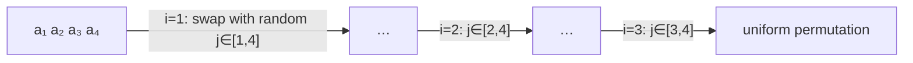

# Random Permutations & Sampling

## What it is
Randomised algorithms often need a **uniformly random permutation** of the input (to defeat adversarial inputs, as in [randomized quicksort](#/randomized_quicksort)). Section 5.3 presents two ways to build one and analyses their correctness.

## How it works
* **PERMUTE-BY-SORTING** — assign each element a random priority from `1…n³` and sort by priority. With priorities drawn from `n³` values, the probability of any tie is below `1/n`, so the result is uniform (conditioned on no ties). Θ(n lg n).
* **RANDOMIZE-IN-PLACE** — for `i = 1…n` swap `A[i]` with `A[RANDOM(i, n)]`. Proven uniform via a loop invariant over `(n−i+1)`-permutations. Θ(n).
* **RANDOM-SAMPLE(m, n)** (Exercise 5.3-7) — recursively pick an `m`-subset.
* **RANDOM(a, b) from coin flips** (Exercise 5.1-2) — draw ⌈lg(b−a+1)⌉ bits and reject values that are too large.

A classic bug (Exercise 5.3-1 and below) is `PERMUTE-WITH-ALL`, which swaps with `RANDOM(1,n)`: it produces `nⁿ` equally likely outcomes, which cannot be uniform over `n!` permutations for `n > 2`.

## Complexity
`randomize_in_place` Θ(n) time, O(1) space; `permute_by_sorting` Θ(n lg n).

## When to use it
Shuffling decks and training data, randomised quicksort and selection, Monte-Carlo simulation, and any time input-order assumptions must be removed.

## In this implementation
All three procedures use the deterministic `crate::common::Rng`. Tests check that outputs are permutations and that a 3-element shuffle hits all 6 outcomes with near-equal frequency.
