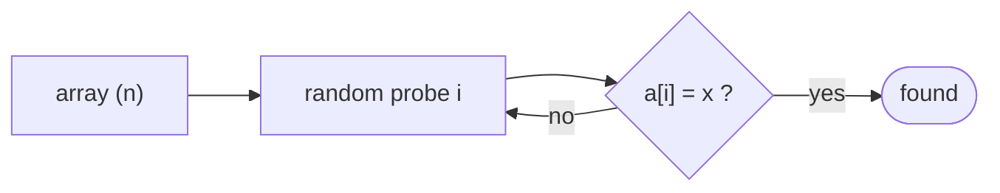

# Searching an Unsorted Array (Randomized)

## What it is
Problem 5-2 compares three ways to find a value `x` in an unsorted array of `n` elements, showing how randomisation changes the analysis even when it cannot beat the deterministic worst case.

## How it works
* **RANDOM-SEARCH** picks indices uniformly *with replacement* until `x` is found, stopping once every index has been probed. With exactly one match the number of probes is geometric with success probability `1/n`: expected **n**. With `k` matches: expected **n/k**. If `x` is absent it is the coupon-collector problem: expected **n H_n ≈ n ln n** probes.
* **Random permutation order** (without replacement) finds a single match after `(n+1)/2` probes on average; with `k` matches `(n+1)/(k+1)`; an absent `x` costs exactly `n`.
* **Deterministic scan**: worst case `n`, average `(n+1)/2` *only if* the input position of `x` is uniformly random — randomisation gives that guarantee for every input.

## Complexity
Expected probes: `n` (with replacement, `k=1`), `(n+1)/2` (permutation), `n·H_n` / `n` when absent.

## When to use it
A clean exercise in indicator variables, geometric and coupon-collector distributions; the practical lesson is that sampling *without* replacement is strictly better, and that randomised order protects against adversarial arrangements (compare [random permutations](#/random_permutation) and [probabilistic analysis](#/probabilistic_analysis)).

## In this implementation
All three searchers report probe counts; tests check the means (`50`, `25.5`, `n·H_n`) by Monte-Carlo simulation.
