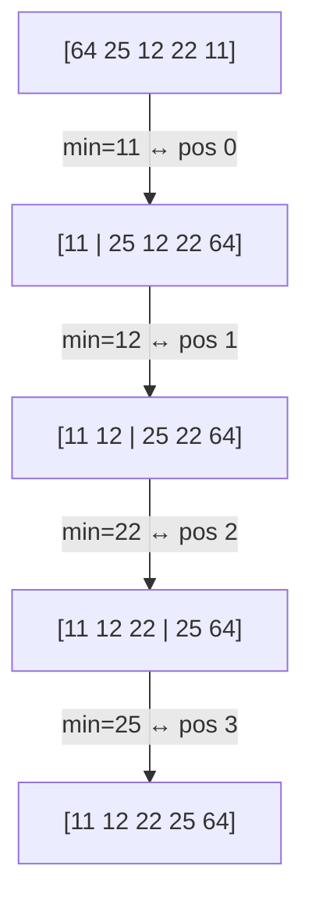

# Selection Sort

## What it is
Exercise 2.2-2 of CLRS: find the smallest element of `A`, swap it into position 1, then the second smallest into position 2, and so on. The book uses it to practise loop invariants and to show that an algorithm can have the **same** Θ(n²) running time in every case.

## How it works

Invariant: `A[1..i-1]` contains the `i-1` smallest elements in sorted order. Only the first `n-1` elements need to be selected — the last is then automatically in place.

## Complexity
Θ(n²) comparisons in best, average and worst case, but only Θ(n) swaps (at most `n-1`). O(1) space; not stable in this form.

## When to use it
When writes are far more expensive than reads (e.g. flash memory) because it performs the minimum number of swaps. Otherwise prefer insertion sort or an O(n lg n) algorithm.

## In this implementation
Generic over `PartialOrd`; tested against `slice::sort`.
