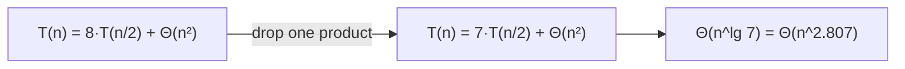

# Strassen's Algorithm

## What it is
In 1969 Volker Strassen showed that matrix multiplication can be done with fewer than n³ scalar multiplications. It is the textbook example that a clever algebraic trick can change the exponent of a recurrence.

## How it works
Split into quadrants like the [recursive method](#/matrix_multiply) but compute only **seven** products of `n/2 × n/2` matrices, using extra additions/subtractions:

```
P1 = A11·(B12 − B22)        P5 = (A11 + A22)·(B11 + B22)
P2 = (A11 + A12)·B22        P6 = (A12 − A22)·(B21 + B22)
P3 = (A21 + A22)·B11        P7 = (A11 − A21)·(B11 + B12)
P4 = A22·(B21 − B11)

C11 = P5 + P4 − P2 + P6     C12 = P1 + P2
C21 = P3 + P4               C22 = P5 + P1 − P3 − P7
```



## Complexity
Θ(n^lg 7) ≈ Θ(n^2.81) arithmetic operations; Θ(n²) extra space per level. Asymptotically faster than Θ(n³) once n is a few hundred, which is why the implementation switches to the plain loop below a cutoff.

## When to use it
Large dense matrices over rings (including exact integer arithmetic). It is numerically less stable than the classical method, so floating-point libraries rarely use it. Better exponents (Coppersmith–Winograd and successors, ≈ n^2.37) are known but impractical.

## In this implementation
`strassen_pow2` handles power-of-two sizes with a configurable cutoff; `strassen` pads arbitrary sizes with zeros (the book's Exercise 4.2-3). Verified against the triple loop for n = 1…12.
