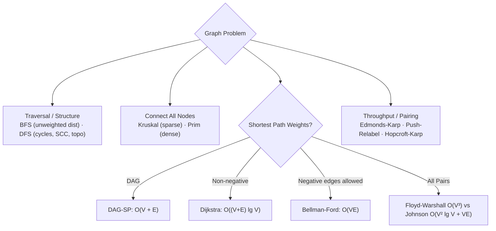

# Graph Algorithms

## Introduction
Graphs model anything made of objects and connections: road maps, social networks, software dependencies, internet routing, airline schedules, and matching students to internships. Part VI is the largest part of CLRS because graph problems vary wildly depending on three details: are edges **directed**, do they have **weights** (possibly negative?), and are you asking for **reachability**, **cheapest connection**, **shortest path**, or **maximum throughput**?

## What Problem Is It Solving?
- **Graph representation & traversal:** Store sparse vs. dense graphs ([Graph Representations](#/graph_representations)), visit nodes level-by-level ([BFS](#/breadth_first_search)) or depth-first ([DFS](#/depth_first_search)), order dependencies ([Topological Sort](#/topological_sort)), collapse cycles ([Strongly Connected Components](#/strongly_connected_components)), and find single points of failure ([Biconnected Components](#/biconnected_components)).
- **Minimum Spanning Trees (MST):** Connect all $V$ vertices in an undirected weighted graph with minimum total wire/road cost ([Kruskal](#/mst_kruskal), [Prim](#/mst_prim), [Borůvka](#/boruvka), [Bottleneck Spanning Trees](#/bottleneck_spanning_tree)).
- **Single-Source & All-Pairs Shortest Paths (SSSP / APSP):** Find fastest routes from one source or between every pair of vertices ([Dijkstra](#/dijkstra), [DAG Shortest Paths](#/dag_shortest_paths), [Bellman-Ford](#/bellman_ford), [Floyd-Warshall](#/floyd_warshall), [Johnson](#/johnson), [Closed-Semiring Paths](#/semiring_paths)).
- **Network Flow & Min-Cut:** Route maximum traffic from source $s$ to sink $t$ respecting edge capacities, or find minimum bottlenecks ([Ford-Fulkerson / Edmonds-Karp](#/ford_fulkerson), [Push-Relabel](#/push_relabel), [Widest Augmenting Path](#/widest_augmenting_path), [Global Min-Cut](#/global_min_cut), [Project Selection](#/project_selection_closure)).
- **Bipartite Matching & Assignment (4th ed. Ch. 25):** Pair two groups optimally—unweighted max pairs ([Hopcroft-Karp](#/hopcroft_karp)), min-cost pairing ([Hungarian](#/hungarian)), or preference stability ([Stable Matching](#/stable_matching)).

## Algorithms & Trade-Offs

| Family / Comparison | Complexity | Key Condition / Assumption | Trade-Off |
|---|---|---|---|
| **Adjacency List** vs. **Matrix** ([Representations](#/graph_representations)) | $\Theta(V+E)$ space vs. $\Theta(V^2)$ space | Sparse ($E \ll V^2$) vs. Dense | Lists save huge memory and traverse neighbors fast; matrices check edge `(u,v)` in $O(1)$ and power algebraic methods ([APSP Matrix Mult](#/apsp_matrix_mult)). |
| [BFS](#/breadth_first_search) vs. [DFS](#/depth_first_search) | Both $\Theta(V + E)$ | Unweighted graphs | BFS guarantees shortest hop-count paths (uses a queue, higher memory on wide graphs); DFS reveals graph structure (cycles, topological order, articulation points, SCCs) via timestamps. |
| [Kruskal](#/mst_kruskal) vs. [Prim](#/mst_prim) | $O(E \lg E)$ vs. $O(E \lg V)$ (binary heap) / $O(E + V \lg V)$ (Fib) | Undirected connected weighted graph | Kruskal sorts edges and uses [Union-Find](#/disjoint_set) (great for sparse graphs or pre-sorted edges); Prim grows one tree outward (wins on dense graphs with adjacency arrays or Fibonacci heaps). |
| [DAG-SP](#/dag_shortest_paths) vs. [Dijkstra](#/dijkstra) vs. [Bellman-Ford](#/bellman_ford) | $O(V+E)$ vs. $O((V+E)\lg V)$ vs. $O(VE)$ | Acyclic vs. $w \ge 0$ vs. arbitrary $w$ | Never pay $O(VE)$ unless negative weights can occur! Dijkstra's greedy lock-in breaks on negative edges; DAG-SP handles negative weights in linear time when acyclic (plus solves [Difference Constraints](#/difference_constraints) & [Arbitrage](#/arbitrage) with Bellman-Ford). |
| [Floyd-Warshall](#/floyd_warshall) vs. [Johnson](#/johnson) | $\Theta(V^3)$ vs. $O(V^2 \lg V + VE)$ | All-pairs shortest paths | Floyd-Warshall is 5 lines of triple-loop DP with tiny constants—best for dense graphs. Johnson reweights once with Bellman-Ford then runs $V$ Dijkstras—much faster on sparse graphs. |
| [Edmonds-Karp](#/ford_fulkerson) vs. [Push-Relabel](#/push_relabel) vs. [Capacity Scaling](#/scaling_max_flow) | $O(VE^2)$ vs. $O(V^3)$ vs. $O(E^2 \lg C)$ | Integer/real capacities | Edmonds-Karp is easy to debug and understand via BFS augmenting paths; Push-Relabel works locally on preflows and dominates in practice on dense/large networks. |
| [Hopcroft-Karp](#/hopcroft_karp) vs. [Hungarian](#/hungarian) vs. [Stable Matching](#/stable_matching) | $O(E\sqrt{V})$ vs. $O(V^3)$ vs. $O(n^2)$ | Bipartite matching | Hopcroft-Karp finds max cardinality; Hungarian optimizes total edge weight; Gale-Shapley optimizes mutual ranked *stability* (note: proposer-optimal, not weight-maximizing). |

## Quick Rules of Thumb for CS Students
- **Always classify the graph first:** Directed vs. undirected, cyclic vs. DAG, positive vs. negative weights immediately narrows your choice to 1–2 textbook algorithms.
- **Don't confuse MST with Shortest Path:** A Minimum Spanning Tree minimizes the *sum of all edges* to connect everyone; a Shortest-Path Tree minimizes distance *from one root* $s$. They are often different trees!
- **Max-Flow Min-Cut is a modeling superpower:** Dozens of seemingly unrelated puzzles ([Bipartite Matching](#/maximum_bipartite_matching), [Escape Problem](#/escape_problem), [Project Selection](#/project_selection_closure), [Min Path Cover](#/min_path_cover)) reduce directly to max flow.
