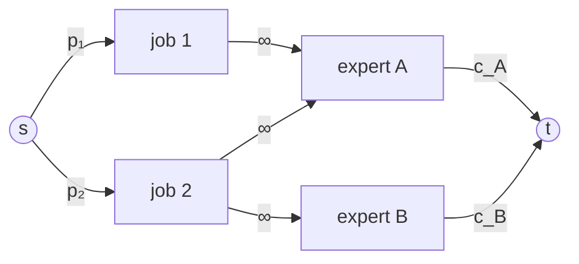

# Algorithmic Consulting (Project Selection by Min-Cut)

## What it is
A consulting firm can accept any subset of **jobs**; job `j` pays a profit `p_j` but requires certain **experts**, and each expert has a one-off hiring fee `c_e` that is paid once however many accepted jobs use them. Which jobs should the firm take to maximise `Σ profits − Σ fees`? Problem 26-3 shows this is a **minimum-cut** problem — the classic *project selection* or *maximum-weight closure* reduction — so it is solvable in polynomial time even though the number of subsets is exponential.

## How it works
Build a flow network:
* source → job `j` with capacity `p_j`;
* job `j` → expert `e` with **infinite** capacity for every expert it needs;
* expert `e` → sink with capacity `c_e`.

Any finite `s–t` cut either *rejects* job `j` (cutting `s → j`, losing `p_j`) or accepts it and then, because the infinite edges cannot be cut, must place all its experts on the source side, cutting their `e → t` edges (paying `c_e` each, once). Hence **cut capacity = (profit of rejected jobs) + (fees of hired experts)** and

`max net profit = Σ p_j − min cut`.

The source side of a [minimum cut](#/ford_fulkerson) tells which jobs to accept and which experts to hire.

## Complexity
One max-flow computation on `jobs + experts + 2` vertices: polynomial, e.g. `O(V E²)` with Edmonds–Karp.

## When to use it
Open-pit mining (blocks and the blocks above them), choosing software features with dependencies, selecting tasks with shared equipment, image segmentation (the same cut structure), and any selection problem where choosing an item *requires* a set of other costly items.

## In this implementation
Built on `FlowNetwork`; the accepted jobs and hired experts are read off the minimum cut. Tests compare the optimum value, and the value of the returned selection, with exhaustive search over all job subsets on 200 random instances.
