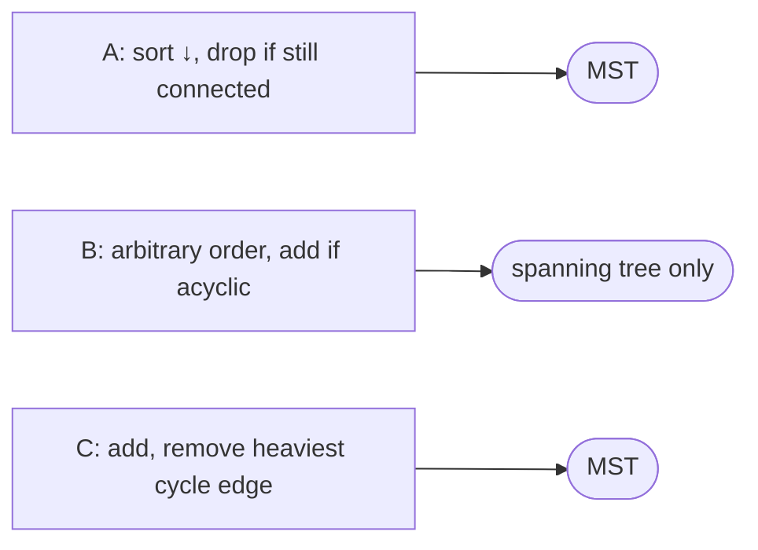

# Alternative MST Algorithms (MAYBE-MST-A/B/C)

## What it is
Problem 23-4 presents three plausible-looking algorithms for a connected, weighted undirected graph and asks which of them really compute a minimum spanning tree. It is a good exercise in testing an algorithm against the [cut and cycle properties](#/generic_mst).

## How it works
* **MAYBE-MST-A** *(correct)* — sort the edges by weight in **decreasing** order; go through them, deleting an edge if the graph remains connected without it. (*Reverse-delete*.) Correct by the **cycle property**: the heaviest edge on any cycle belongs to no MST (with distinct weights); the surviving edges contain no cycle, since every cycle's heaviest edge was deletable when it was considered.
* **MAYBE-MST-B** *(wrong)* — keep `T = ∅`; scan the edges in **arbitrary** order, adding each edge that does not create a cycle. This yields *a* spanning tree but not a minimum one: with a triangle of weights 9, 5, 1 presented heaviest-first it picks 9 and 5 instead of 1 and 5. (Only the *sorted* order — Kruskal — makes this greedy correct.)
* **MAYBE-MST-C** *(correct)* — scan the edges in arbitrary order, add each to `T`, and whenever a cycle appears **delete a maximum-weight edge on it**. After each step `T` is a minimum spanning forest of the edges seen so far (induction with the cycle property).

## Complexity
A: `O(E(V+E))` with naive connectivity tests (`O(E lg V (lg lg V)³)` with dynamic connectivity); B: `O(E α)`; C: `O(E·V)` naive (`O(E lg V)` with link-cut trees).

## When to use it
Reverse-delete is easy to explain and parallelises; algorithm C is the basis of *incremental MST* maintenance (inserting edges into a dynamic graph) and of the "online" MST update used in network design tools.

## In this implementation
Tests on 150 shuffled random graphs verify that A and C match [Kruskal](#/mst_kruskal) while B is strictly heavier on more than 10 of them.
