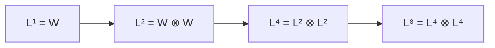

# APSP by Matrix Multiplication

## What it is
All-pairs shortest paths can be phrased as **matrix multiplication over the (min, +) semiring**. Let `L^(m)` hold the minimum weights of paths with at most `m` edges. Section 25.1 derives two algorithms, a precursor to [Floyd–Warshall](#/floyd_warshall).

## How it works
`L^(m)_ij = min_k ( L^(m−1)_ik + w_kj )` — "ordinary" matrix product with `+` replaced by `min` and `×` by `+`. `L^(1) = W` (the weight matrix with 0 on the diagonal).

* **SLOW-ALL-PAIRS-SHORTEST-PATHS** computes `L^(1), L^(2), …, L^(n−1)`: `n − 2` products, **Θ(n⁴)**.
* **FASTER-ALL-PAIRS-SHORTEST-PATHS** uses **repeated squaring** — `L^(2m) = L^(m) ⊗ L^(m)` — to reach `L^(≥ n−1)` in `⌈lg(n−1)⌉` products: **Θ(n³ lg n)**. This is valid because min-plus multiplication is associative and shortest paths never use more than `n−1` edges (no negative cycles).

There is no known way to reuse fast (Strassen-like) matrix multiplication because `min` has no inverse (no subtraction); the best known results are only subcubic by a log factor.

## Complexity
Θ(V⁴) (slow) and Θ(V³ lg V) (fast), versus Θ(V³) for Floyd–Warshall.

## When to use it
Primarily instructive: it shows the link between linear algebra and graph algorithms, which is exploited by GraphBLAS libraries (e.g. computing paths of exactly `k` edges, boolean reachability, tropical-semiring DP).

## In this implementation
`extend_shortest_paths` is the (min,+) product; both algorithms are verified against Floyd–Warshall on random graphs.
