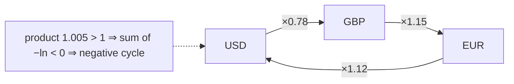

# Currency Arbitrage

## What it is
Let `R[i][j]` be the number of units of currency `j` you receive for one unit of currency `i`. An **arbitrage opportunity** is a sequence of currencies `c₁, c₂, …, c_k, c₁` with `R[c₁][c₂] · R[c₂][c₃] ⋯ R[c_k][c₁] > 1` — a risk-free profit. Problem 24-3 asks for an efficient algorithm to detect and print one.

## How it works
Products are awkward; logarithms turn them into sums. Give the edge `(i, j)` the weight `w(i,j) = −ln R[i][j]`. Then

`R[c₁][c₂] ⋯ R[c_k][c₁] > 1  ⇔  Σ w < 0`,

so an arbitrage cycle is exactly a **negative-weight cycle** in the currency graph. Run [Bellman–Ford](#/bellman_ford) from a virtual source (all distances start at 0) for `n` rounds; if the `n`-th round still relaxes an edge, the last relaxed vertex is reachable from a negative cycle: step back `n` times along the predecessors to land *on* the cycle and read it off (as in [Exercise 24.1-6](#/bellman_ford)). Time `O(n³)` for a complete table (`O(VE)`).

Consistent rates `R[i][j] = pⱼ/pᵢ` (derived from one price vector) telescope to product 1 around every cycle, so they never admit arbitrage.

## Complexity
`O(V·E) = O(n³)` for an `n`-currency table.

## When to use it
Detecting inconsistencies in exchange-rate or price tables (FX, crypto triangular arbitrage), checking calibration of unit-conversion tables, and as the textbook application of negative-cycle detection and [difference constraints](#/difference_constraints).

## In this implementation
Floating-point with a `1e-12` tolerance. Tests build consistent tables (no arbitrage allowed), plant a 20 % mispricing (a profitable cycle must be found, with product > 1), and compare detection with exhaustive cycle enumeration on 200 random tables.
