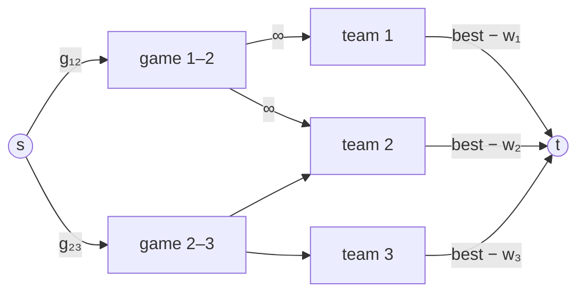

# Baseball Elimination

## What it is
During a baseball season, which teams are **mathematically eliminated** from first place? Team `k` is eliminated if, no matter how the remaining games turn out, some other team finishes with strictly more wins than the most team `k` can reach, even if `k` wins all of its own remaining games. A classic *application of maximum flow*, popularised by Schwartz (1966) and included among the flow problems of Chapter 26.

## How it works
Let `wᵢ` be the current wins, `g_{ij}` the games left between `i` and `j`, and `best = w_k + Σ_j g_{kj}`. If some `wᵢ > best`, team `k` is trivially eliminated. Otherwise decide whether the games *not involving* `k` can be distributed so that every team `i` gains at most `best − wᵢ` wins:

* **source → game node `(i, j)`** with capacity `g_{ij}` (the games to hand out);
* **game node → team `i`** and **→ team `j`** with infinite capacity (the winner of the game is `i` or `j`);
* **team `i` → sink** with capacity `best − wᵢ` (how many more games `i` may win without overtaking `k`).

A maximum flow saturating all source edges is a schedule in which nobody overtakes `k`; so **`k` is eliminated iff the maximum flow is less than the total number of remaining games** among the other teams. The min cut identifies the *certificate of elimination* — a subset of teams that together must win too many games.

## Complexity
One max-flow on `O(n²)` nodes and edges per team — polynomial, in contrast to simulating all `2^(games)` outcomes.

## When to use it
Sports analytics (playoff clinching and elimination), and as the textbook example of reducing a *feasibility with budgets* question to flow — compare [bipartite matching](#/maximum_bipartite_matching) and [the escape problem](#/escape_problem).

## In this implementation
Built on this repository's `FlowNetwork` ([Edmonds–Karp](#/ford_fulkerson)). Tests compare with exhaustive enumeration of all game outcomes on 300 random 2–5 team seasons, and check that the current leader is never eliminated.
