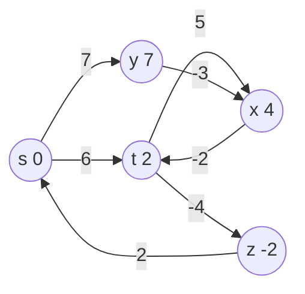

# Bellman-Ford Single-Source Shortest Paths

## What it is
The **single-source shortest-paths problem** asks for the minimum-weight path from a source `s` to every vertex of a weighted directed graph. **Bellman–Ford** handles *negative edge weights* and **detects negative-weight cycles** reachable from `s` (in which case shortest paths are undefined).

## How it works
The algorithm is built on **relaxation**: `RELAX(u, v, w)` lowers the estimate `d[v]` if the path through `u` is shorter. Key properties (Chapter 24): the *triangle inequality*, the *upper-bound property* (`d[v] ≥ δ(s,v)` always), the *convergence property* and the *path-relaxation property* (relaxing the edges of a shortest path in order makes the estimates exact).

* Repeat `|V| − 1` times: relax every edge. A shortest path has at most `|V|−1` edges, so after pass `i` all vertices whose shortest path has ≤ `i` edges are exact.
* Then make one more pass: if any edge can still be relaxed there is a negative cycle reachable from `s`; return FALSE.

## Complexity
Θ(V·E) time (early exit when a pass changes nothing).

## When to use it
Graphs with negative weights: currency arbitrage detection (negative cycle in `−log` exchange rates), [difference constraints](#/difference_constraints), distance-vector routing (RIP), and as the reweighting step of [Johnson's algorithm](#/johnson). With non-negative weights prefer [Dijkstra](#/dijkstra).

## In this implementation
`bellman_ford` returns `Option<(dist, pred)>`; `find_negative_cycle` (Exercise 24.1-6) extracts an explicit cycle by walking predecessors `n` steps back. Random graphs are cross-checked with Floyd–Warshall.
