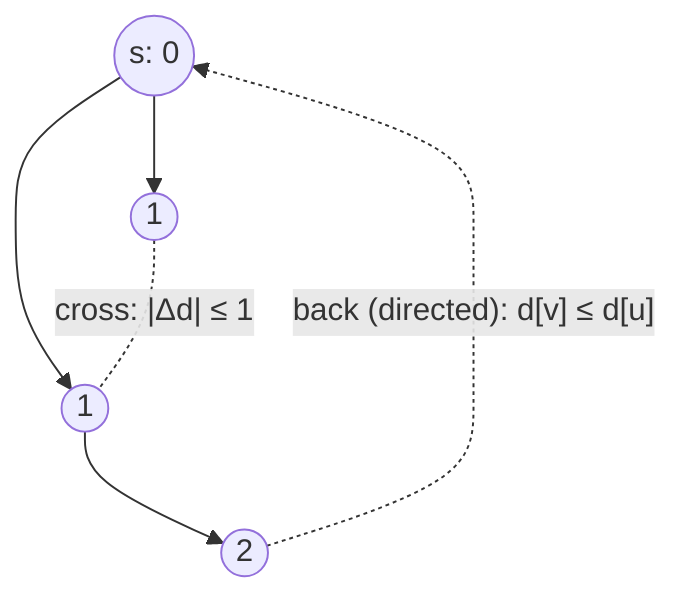

# Classifying Edges by Breadth-First Search

## What it is
[Depth-first search](#/depth_first_search) classifies edges as tree, back, forward or cross. Problem 22-1 asks what [breadth-first search](#/breadth_first_search) does. The answer reveals how different the two traversals are.

## How it works
**Directed graphs.** After BFS from `s`, for every edge `(u, v)` with `u` reachable:
* **no forward edges** exist: if `u` were a proper ancestor of `v` through a non-tree edge, BFS would have discovered `v` directly from `u`;
* every edge satisfies `d[v] ≤ d[u] + 1` (the shortest-path property: `d[v] = δ(s,v) ≤ δ(s,u) + 1`);
* **tree** edges have `d[v] = d[u] + 1`; **back** edges go to an ancestor (`d[v] ≤ d[u]`); **cross** edges connect vertices of different branches.

**Undirected graphs.** Every edge is a tree edge or a cross edge: for each non-tree edge `{u, v}` we have `d[v] = d[u]` or `d[v] = d[u] ± 1` — **never** an ancestor/descendant pair beyond parent–child, because that would give `|d[u] − d[v]| ≥ 2`. (In DFS of an undirected graph the situation is the opposite: only tree and back edges occur.) These facts underlie the use of BFS for [bipartiteness testing](#/breadth_first_search) — an odd cycle appears exactly as a non-tree edge between two vertices at equal depth.

## Complexity
`Θ(V + E)` for the BFS; the ancestor test used for classification here walks parent pointers (`O(depth)` per edge).

## When to use it
Reasoning about BFS-based algorithms: shortest paths, level graphs of [Edmonds–Karp](#/ford_fulkerson) and Dinic, bipartite checks. Contrasts with the DFS timestamp classification.

## In this implementation
200 random digraphs confirm "no forward edges" and `d[v] ≤ d[u] + 1`; 200 random undirected graphs confirm that non-tree edges join vertices at depths differing by at most one.
