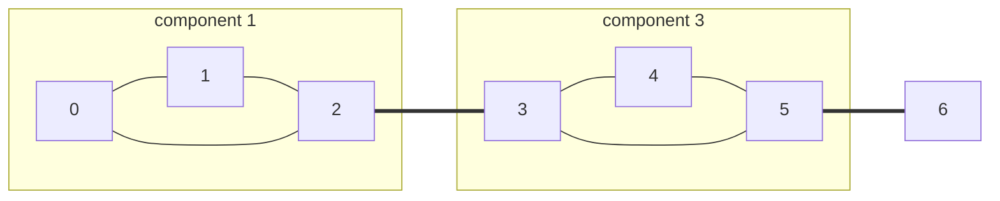

# Articulation Points, Bridges & Biconnected Components

## What it is
In an undirected connected graph:
* an **articulation point** (cut vertex) is a vertex whose removal disconnects the graph;
* a **bridge** is an edge whose removal disconnects it;
* a **biconnected component** is a maximal set of edges such that any two lie on a common simple cycle. Components overlap only at articulation points.

Problem 22-2 asks you to characterise them with a depth-first tree and compute them in `O(E)`.

## How it works
Run [DFS](#/depth_first_search), recording `d[v]` and the **low-link** `low[v]` = the smallest discovery time reachable from the subtree of `v` by at most one back edge:

`low[v] = min( d[v], d[w] for back edges (v, w), low[c] for tree children c )`.

* the **root** is an articulation point iff it has ≥ 2 DFS children;
* a non-root `u` is an articulation point iff some child `c` has `low[c] ≥ d[u]`;
* edge `(u, c)` is a **bridge** iff `low[c] > d[u]`;
* keep a stack of edges: when `low[c] ≥ d[u]` pop it down to `(u, c)` — those edges form one biconnected component.

(Double lines are bridges; vertices 2, 3, 5 are articulation points.)

## Complexity
Θ(V + E).

## When to use it
Network reliability (single points of failure), road/pipe network design, circuit layout (planarity testing starts with biconnected decomposition), and splitting graph problems into independent blocks.

## In this implementation
Edges carry ids so parallel edges are handled correctly (a doubled edge is not a bridge). Tests compare the output with the brute-force definition ("remove it and recount components") on random multigraphs.
