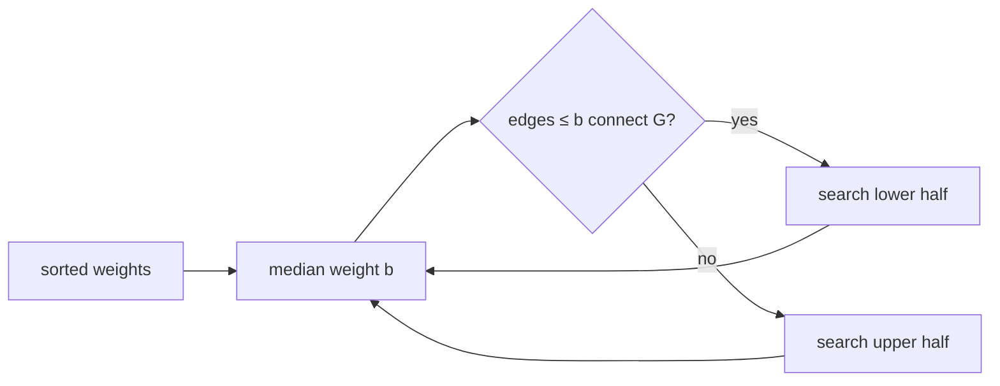

# Bottleneck Spanning Trees

## What it is
A **bottleneck spanning tree** `T` of an undirected weighted graph minimises the weight of its *heaviest* edge, `max_{e∈T} w(e)` (think of a network whose speed is limited by its slowest link). Problem 23-3 explores how it relates to the [minimum spanning tree](#/mst_kruskal).

## How it works
* **(a) Every MST is a minimum bottleneck spanning tree.** Suppose a spanning tree `T'` had a lighter bottleneck than the MST `T`, whose heaviest edge `e` weighs more. Remove `e` from `T`; the cut it defines is crossed by some edge of `T'` with weight `< w(e)`, and swapping it in gives a spanning tree *lighter* than `T` — contradicting minimality. The converse is false: a bottleneck tree need not be an MST.
* **(b) Decision version:** *is there a spanning tree with bottleneck ≤ b?* — yes iff the subgraph of edges with weight `≤ b` is connected: a single DFS/union-find pass, `O(V + E)`.
* **(c) Optimisation:** binary search over the sorted weights with that test (`O(E lg E)`); the problem also admits a **linear-time** algorithm that repeatedly finds the median edge weight with [SELECT](#/select_linear_time), tests connectivity of the lighter half, and recurses on one half after contracting components.

## Complexity
Decision `O(V + E)`; binary search `O(E lg E)`; randomised/median algorithms `O(V + E)`.

## When to use it
Capacity planning (the minimax path/tree problem), network design under a worst-link criterion, clustering (single-linkage cuts = bottleneck structure), and the *minimax shortest path* variant.

## In this implementation
Tests enumerate **all** spanning trees of small graphs, confirming the minimum bottleneck found by search, and that Kruskal's MST attains it.
