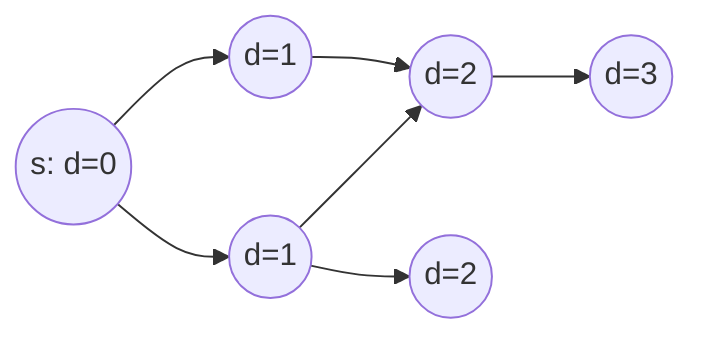

# Breadth-First Search

## What it is
BFS explores a graph outward from a source vertex `s`, visiting all vertices at distance `k` before any at distance `k+1`. It computes the **shortest-path distance** (fewest edges) from `s` to every reachable vertex and a **breadth-first tree** of predecessors. It is the prototype for [Prim's algorithm](#/mst_prim) and [Dijkstra's algorithm](#/dijkstra).

## How it works
Colour vertices white (undiscovered), gray (in the queue), black (finished). Keep a FIFO queue:
1. Mark `s` gray, `d[s] = 0`, enqueue it.
2. Dequeue `u`; for every white neighbour `v` set `d[v] = d[u] + 1`, `π[v] = u`, mark gray and enqueue.
3. Mark `u` black.

Theorem 22.5 proves `d[v] = δ(s, v)`, the true shortest-path length; Lemma 22.3 shows the queue holds vertices with `d` values `k, …, k, k+1, …, k+1` (monotone).

## Complexity
Θ(V + E) with adjacency lists (each vertex enqueued once, each edge examined once or twice).

## When to use it
Unweighted shortest paths, connected components, level-order tree traversal, web crawling, puzzle solving (Rubik's cube moves), and flow augmenting paths ([Edmonds–Karp](#/ford_fulkerson)). Applications in the exercises: bipartiteness testing (2-colour by level parity) and the diameter of a tree (BFS from any vertex to the farthest vertex, then BFS again).

## In this implementation
`bfs` returns `Option` distances/predecessors; `path` reconstructs a route (`PRINT-PATH`); `is_bipartite` and `tree_diameter` are the exercise applications. Random graphs are cross-checked against Floyd–Warshall.
