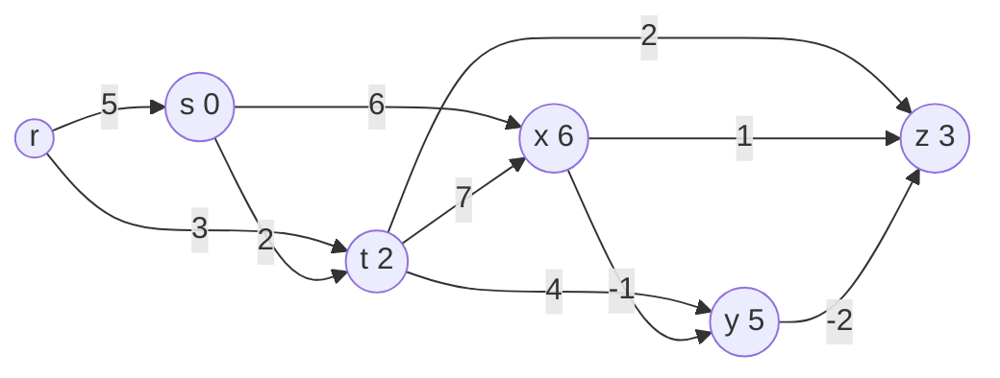

# Shortest Paths in a DAG

## What it is
In a **directed acyclic graph** shortest paths are easy even with negative weights — no negative cycle can exist. Topologically sorting the vertices lets us relax each edge exactly once, in an order that guarantees every shortest path is relaxed front to back (the path-relaxation property).

## How it works
1. [Topologically sort](#/topological_sort) the vertices.
2. Initialise `d[s] = 0`, all others `∞`.
3. For each vertex `u` in topological order, relax every edge `(u, v)`.

Because all predecessors of `u` come before `u`, its estimate is final when `u` is processed.

Negating the weights turns this into a **longest-path** algorithm — the *critical-path method* for PERT charts (Section 24.2): the longest path in a task DAG is the minimum project duration.

## Complexity
Θ(V + E).

## When to use it
Project scheduling, build pipelines, dynamic programs defined on DAGs (every DP is a shortest/longest-path problem in its subproblem DAG; see [rod cutting](#/rod_cutting)), genome assembly.

## In this implementation
Uses an internal Kahn ordering; `dag_longest_paths` returns `None` for unreachable vertices. Random DAGs with negative weights are compared with [Bellman–Ford](#/bellman_ford).
