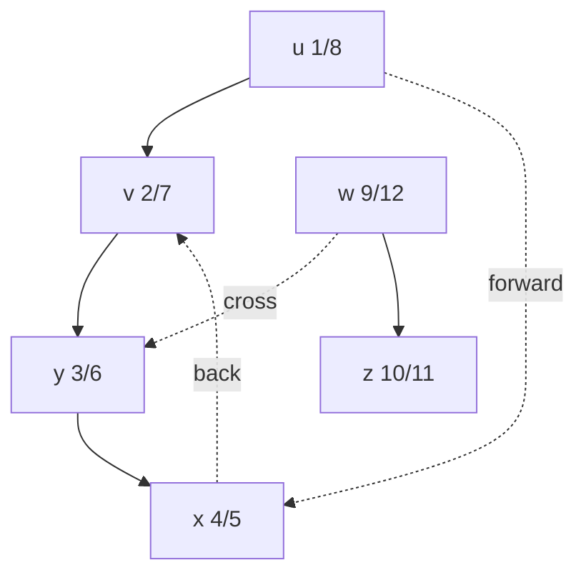

# Depth-First Search

## What it is
DFS explores as deep as possible along each branch before backtracking. It timestamps each vertex with a **discovery time** `d[v]` and **finish time** `f[v]` and produces a **depth-first forest**. These timestamps reveal the structure of the graph and power topological sort, strongly connected components, cycle detection and biconnectivity.

## How it works
Colour vertices white/gray/black. `DFS-VISIT(u)` marks `u` gray, records `d[u]`, recursively visits each white neighbour, then marks `u` black and records `f[u]`.

**Parenthesis theorem.** For any `u, v` either the intervals `[d,f]` are disjoint or one contains the other; the latter happens exactly when one is a descendant of the other (white-path theorem: `v` is a descendant of `u` iff at time `d[u]` there is a path of white vertices from `u` to `v`).

**Edge classification** when examining `(u, v)`:
| `v` is… | kind |
|---|---|
| white | **tree** edge |
| gray | **back** edge (a cycle!) |
| black, `d[u] < d[v]` | **forward** edge |
| black, `d[u] > d[v]` | **cross** edge |

## Complexity
Θ(V + E).

## When to use it
Cycle detection (a directed graph is acyclic iff DFS yields no back edge), [topological sorting](#/topological_sort), [strongly connected components](#/strongly_connected_components), [articulation points](#/biconnected_components), maze solving.

## In this implementation
Iterative (explicit stack) so deep graphs cannot overflow the call stack. The tests assert the parenthesis theorem and the timestamp pattern that characterises each edge kind on random digraphs, plus the timestamps of Figure 22.4.
