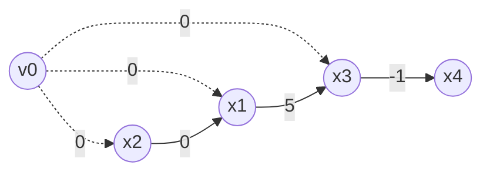

# Difference Constraints

## What it is
A system of **difference constraints** is a set of inequalities `x_j − x_i ≤ b_k`. It is a special case of linear programming (the constraint matrix has one `+1` and one `−1` per row), and Section 24.4 shows it can be solved much faster — as a *shortest-paths* problem.

## How it works
Build the **constraint graph**: one vertex per variable, plus a new source `v₀`; for each constraint `x_j − x_i ≤ b` add edge `v_i → v_j` of weight `b`, and add 0-weight edges from `v₀` to every vertex. Run [Bellman–Ford](#/bellman_ford) from `v₀`:
* if no negative cycle exists, `x_i = δ(v₀, v_i)` is a feasible solution (the triangle inequality `δ(v₀,v_j) ≤ δ(v₀,v_i) + b` is exactly the constraint);
* a negative-weight cycle proves infeasibility: summing the constraints around it yields `0 ≤ negative`.

Adding a constant to every variable keeps a solution feasible.

## Complexity
O(V·E) with `n + 1` vertices and `m + n` edges.

## When to use it
Scheduling with relative timing constraints, timing analysis in circuit design (setup/hold constraints), difference-bound matrices in program analysis, layout compaction in VLSI.

## In this implementation
`solve(n, &constraints)` returns `Some(x)` or `None`; the book's system (Figure 24.8) yields `x = (−5, −3, 0, −1, −4)`. Infeasible random systems are verified by brute force on a bounded box.
