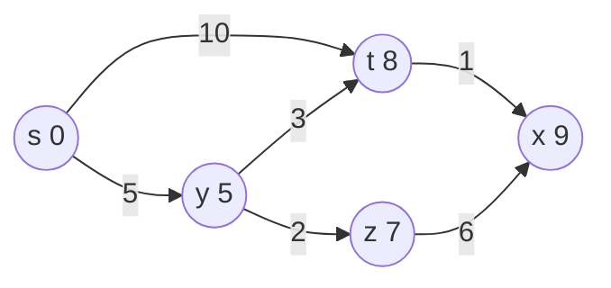

# Dijkstra's Algorithm

## What it is
Dijkstra's algorithm (1959) solves the single-source shortest-paths problem on weighted graphs whose edge weights are **non-negative**. It is greedy: it repeatedly finalises the closest not-yet-finalised vertex.

## How it works
Keep a set `S` of vertices whose shortest-path distance is final and a min-priority queue `Q` of the rest keyed by `d[v]`:
1. `d[s] = 0`, others `∞`.
2. Extract `u` with the smallest `d[u]` and add it to `S`.
3. Relax all edges leaving `u`.

**Correctness (loop invariant).** When `u` is added to `S`, `d[u] = δ(s,u)`. Suppose not; take the first vertex `y` outside `S` on a true shortest path to `u` — its predecessor `x` is in `S` and was relaxed, so `d[y] = δ(s,y) ≤ δ(s,u) ≤ d[u]`, but `u` was chosen with `d[u] ≤ d[y]`; hence equality. Non-negative weights are essential: with negative edges the argument (and the algorithm) fails.

## Complexity
| Queue | Time |
|---|---|
| Array | Θ(V²) |
| Binary heap | O((V + E) lg V) |
| [Fibonacci heap](#/fibonacci_heap) | O(V lg V + E) |

## When to use it
Road navigation, network routing (OSPF), game pathfinding (A* adds a heuristic). For negative weights use [Bellman–Ford](#/bellman_ford); for all pairs see [Johnson](#/johnson).

## In this implementation
`BinaryHeap<Reverse<(dist, vertex)>>` with stale-entry skipping replaces DECREASE-KEY; `dijkstra_array` is the Θ(V²) variant. Figure 24.6 and random graphs (vs Bellman–Ford) are tests.
