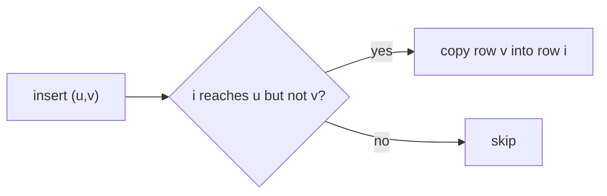

# Transitive Closure of a Dynamic Graph

## What it is
The **transitive closure** of a directed graph records for every ordered pair `(i, j)` whether `j` is reachable from `i`. Problem 25-1 asks to maintain it while edges are **inserted one at a time**, answering reachability queries in `O(1)`. Recomputing with [Floyd–Warshall/Warshall](#/floyd_warshall) after each insertion would cost `Θ(V³)` per edge.

## How it works
Keep the boolean matrix `T` (with `T[i][i] = true`). When edge `(u, v)` is inserted, a vertex `i` can now reach every vertex `j` that `v` reaches, provided `i` already reaches `u`:

```
for each i:   if T[i][u] and not T[i][v]:
                 for each j:   if T[v][j]: T[i][j] = true
```
* **(a)** One insertion therefore costs `O(V²)`.
* **(b) Amortised bound.** The inner loop runs only when `(i, v)` flips from false to true, which can happen at most once for each of the `V²` pairs; each such event costs `O(V)`. So **any sequence of insertions costs `O(V³)` in total** plus `O(V)` for the outer loop per insertion — even if there are `Θ(V²)` insertions, the average per-insertion cost is `O(V)`.



## Complexity
`O(V²)` worst case per insertion; `O(V³)` total for any sequence; queries `O(1)`; space `O(V²)`.

## When to use it
Incremental reachability (build-dependency graphs, access-control inheritance, type hierarchies) when edges only get added. Deleting edges is much harder (fully dynamic reachability).

## In this implementation
`IncrementalClosure` counts its steps; tests compare the matrix with a from-scratch Warshall closure after **every** insertion and check the total-work bound over `4V²` insertions.
