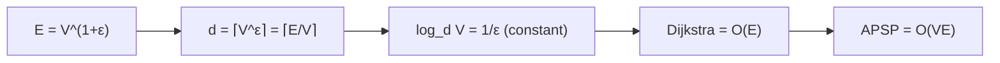

# Shortest Paths in ε-Dense Graphs

## What it is
A graph is **ε-dense** if `|E| = Θ(V^(1+ε))` for a constant `0 < ε ≤ 1`: `ε = 1` is a dense graph (`E ≈ V²`), small `ε` a sparse one. Problem 25-2 asks how fast shortest paths can be found when the priority queue is a **d-ary heap** ([Problem 6-2](#/d_ary_heap)) instead of a binary heap.

## How it works
In [Dijkstra's algorithm](#/dijkstra) the priority queue sees `V` `EXTRACT-MIN` operations and up to `E` `DECREASE-KEY` operations. With a `d`-ary heap:
* `DECREASE-KEY` (sift up) costs `O(log_d V)`;
* `EXTRACT-MIN` (sift down, comparing `d` children per level) costs `O(d·log_d V)`.

So the total is `O((V·d + E) log_d V)`. Choose `d = ⌈V^ε⌉`, so `V·d ≈ E`: then `log_d V = 1/ε` is a **constant** and the total is `O(E/ε) = O(E)` — linear time! Running it from every source (or after [Johnson's](#/johnson) reweighting) gives all-pairs shortest paths in `O(VE)`. For dense graphs this equals the `O(V³)` of [Floyd–Warshall](#/floyd_warshall), but for sparser ε-dense graphs it is strictly faster; with a Fibonacci heap one gets `O(V² lg V + VE)`, which does not need to know ε.

## Complexity
`O(E)` per source for `d = Θ(E/V)`; `O(VE)` for all pairs.

## When to use it
Tuning heap arity in practice: a 4-ary heap is a common default for Dijkstra on road networks, and very large arity helps when graphs are dense.

## In this implementation
`DaryMinHeap` has a position index for decrease-key and counts comparisons. Tests compare `dijkstra_dary` with the binary-heap [Dijkstra](#/dijkstra) for arities 2, 3, 5 and 16 on 150 random graphs, and check that with the prescribed arity the comparison count stays within a constant times `E + V·d·log_d V` for `ε = 0.5` and `0.8`.
