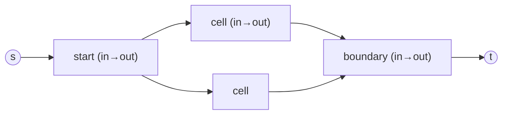

# The Escape Problem

## What it is
An `n × n` grid has `m` starting points. Can all of them reach the boundary of the grid by paths that are **vertex-disjoint** (no two paths share a vertex, including the starting points)? Problem 26-1 shows this is a maximum-flow problem — with a twist, because flow networks normally limit **edges**, not **vertices**.

## How it works
Build a flow network:
* **Split every vertex `v`** into `v_in → v_out` with capacity 1. A path through `v` uses that single unit, so two paths cannot share `v` (this is the standard reduction from vertex capacities to edge capacities).
* For each pair of adjacent grid cells add `u_out → v_in` (capacity 1).
* Add a source with an edge into `v_in` for each starting point, and connect every boundary vertex's `v_out` to a sink.
By the **integrality theorem** a maximum flow can be taken integral, and by flow decomposition it splits into `|f|` vertex-disjoint paths; all points can escape iff `|f| = m`. The network has `O(n²)` vertices and edges and flow value ≤ `m ≤ 4n − 4`, so [Ford–Fulkerson](#/ford_fulkerson) runs in `O(m·n²)`.

## Complexity
`O(n²·m)` with augmenting paths; at most `4(n−1)` points can ever escape (the boundary size).

## When to use it
Robot swarm evacuation and multi-agent path planning on grids, routing wires on a chip (disjoint wire paths), and any "vertex-disjoint paths" question (Menger's theorem; compare [matching](#/maximum_bipartite_matching)).

## In this implementation
The grid network uses this repository's `FlowNetwork`; tests compare the flow value with exhaustive backtracking over vertex-disjoint routes on grids up to 3×3 with up to 4 starting points, and check known solvable/unsolvable layouts.
