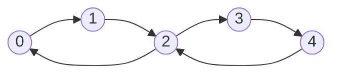

# Euler Tours

## What it is
An **Euler tour** (circuit) of a connected directed graph is a cycle that traverses each *edge* exactly once (it may revisit vertices). Euler solved the Königsberg bridges puzzle in 1736 with the characterisation:
* an **undirected** connected graph has an Euler circuit iff every vertex has **even degree**;
* a **directed** connected graph has one iff `in-degree = out-degree` at every vertex.

Problem 22-3 asks for an `O(E)` algorithm to find one.

## How it works
**Hierholzer's algorithm**: start at any vertex and keep walking along unused edges until stuck — you must be back at the start. While some vertex on the current tour still has unused edges, splice in another closed walk from that vertex. The iterative form uses a stack: push neighbours while edges remain, and when a vertex has none left, pop it to the output; the output (reversed) is the circuit.

Tour: `0 → 1 → 2 → 3 → 4 → 2 → 0`.

## Complexity
Θ(E) time after building adjacency lists; each edge is used once.

## When to use it
Route inspection (the Chinese postman problem), DNA fragment assembly with de Bruijn graphs, plotter/CNC path planning, and de Bruijn sequences. Contrast: finding a *Hamiltonian* cycle (every vertex once) is [NP-complete](#/hamiltonian_cycle).

## In this implementation
Both variants return `None` when the necessary condition fails *or* the edges lie in several components. Tests verify, for random Eulerian multigraphs, that the circuit uses each edge exactly once.
