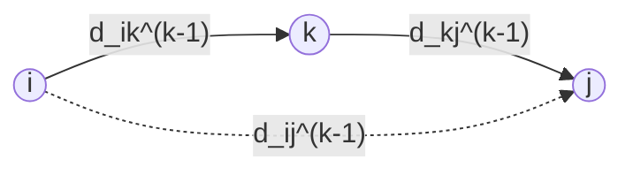

# Floyd-Warshall All-Pairs Shortest Paths

## What it is
Floyd–Warshall computes shortest paths between **all pairs** of vertices of a weighted directed graph (negative edges allowed, no negative cycles) with a three-line triple loop and a dynamic-programming argument.

## How it works
Number the vertices `1…n`. Let `d_ij^(k)` be the weight of a shortest path from `i` to `j` whose *intermediate* vertices all lie in `{1,…,k}`. Either such a path avoids `k`, or it passes through `k` once and splits into two paths using only `{1,…,k−1}`:

`d_ij^(k) = min( d_ij^(k−1),  d_ik^(k−1) + d_kj^(k−1) )`.

Updating a single matrix in place is safe. The predecessor matrix `π_ij` records the last vertex before `j` on the best `i ⇝ j` path, so any path can be printed (`PRINT-ALL-PAIRS-SHORTEST-PATH`). A negative diagonal entry `d_ii < 0` reveals a negative-weight cycle.

**Transitive closure** (Warshall's variant) replaces `min,+` by `or,and`: `t_ij^(k) = t_ij^(k−1) ∨ (t_ik^(k−1) ∧ t_kj^(k−1))` — reachability between all pairs.

## Complexity
Θ(V³) time, Θ(V²) space. Simple and fast for dense graphs; for sparse graphs [Johnson's algorithm](#/johnson) is asymptotically better.

## When to use it
Routing tables, graph diameter/centrality, detecting negative cycles, transitive closure of relations (program analysis, access control).

## In this implementation
Weights use `INF = i64::MAX/4` to avoid overflow; the predecessor matrix follows the book's rule. Figure 25.1's result matrix is a test, and results are compared with Dijkstra from every source.
