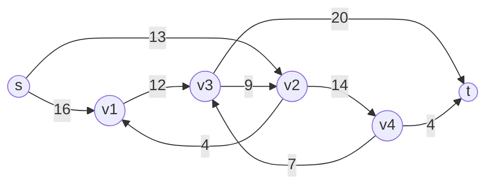

# Ford-Fulkerson & Edmonds-Karp Maximum Flow

## What it is
A **flow network** is a directed graph with edge capacities, a source `s` and a sink `t`. A **flow** respects capacities and conserves flow at internal vertices; its value is the net flow out of `s`. The **maximum-flow problem** asks for a flow of largest value — e.g. how much water a pipe network can carry, or how many packets per second a network can route.

## How it works
The **Ford–Fulkerson method**:
1. Start with zero flow.
2. While the **residual network** `G_f` (edges with spare capacity, plus *reverse edges* that cancel flow) has an **augmenting path** `p` from `s` to `t`, push `c_f(p) =` the minimum residual capacity along `p`.

**Edmonds–Karp** chooses each augmenting path by **BFS** (fewest edges). This bounds the number of augmentations by `O(VE)` (each edge becomes critical `O(V)` times), so the running time is `O(V E²)` regardless of capacities; plain DFS paths can take time proportional to the flow value.

**Max-flow min-cut theorem (Theorem 26.6).** The following are equivalent: `f` is a maximum flow; the residual network has no augmenting path; `|f| = c(S, T)` for some cut. The set `S` of vertices reachable from `s` in the final residual graph is a **minimum cut**.

(Figure 26.1; maximum flow 23.)

## Complexity
Edmonds–Karp `O(V E²)`; Ford–Fulkerson with DFS `O(E · |f*|)` for integer capacities.

## When to use it
Network capacity planning, [bipartite matching](#/maximum_bipartite_matching), project selection, image segmentation (graph cuts), airline scheduling. Faster algorithms: [push-relabel](#/push_relabel) `O(V³)`, Dinic `O(V²E)`.

## In this implementation
Paired edge arrays (edge `e` and reverse `e^1`) store residual capacities. The tests verify that EK and DFS agree, that flow is conserved, and that the min-cut capacity equals the max-flow on random networks.
