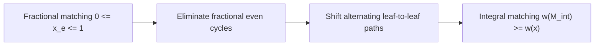

# Fractional Bipartite Matching & Vertex Labels

## What it is
Two fundamental polyhedral theorems for weighted bipartite graphs (CLRS 4e Problems 25-4 & 25-5):
1. **Rounding Fractional Matchings**: Because the bipartite matching polytope has only integral extreme points, any fractional matching $x \in [0, 1]^E$ ($\sum_{e \ni v} x_e \le 1$) can be rounded in $O(E)$ time to an **integral matching** of **at least as large total weight**.
2. **Optimal Dual Vertex Labels from a Matching**: Given a maximum-weight matching $M$, optimal non-negative dual labels $(u_L, v_R)$ satisfying $u_a + v_b \ge w_{ab}$ and $\sum u_a + \sum v_b = w(M)$ (used in the [Hungarian algorithm](#/hungarian)) can be recovered in $O(VE)$ time via [Bellman–Ford](#/bellman_ford) [difference constraints](#/difference_constraints).

## How it works
* **Cycle & path rounding (`round_fractional_matching`)**: Collect edges with $0 < x_e < 1$. While a cycle exists, pick whichever alternating parity (even vs odd edges) has larger weight sum and shift by the maximum $\varepsilon$ preserving $0 \le x_e \le 1$, preserving every vertex's fractional load and strictly removing at least one fractional edge. Once the fractional subgraph is a forest, apply the same alternating parity shift along leaf-to-leaf paths (at a leaf of the fractional subgraph, no $1$-edge is present so the sole fractional edge can shift freely).
* **Dual label recovery (`dual_labels_from_matching`)**: Encode $u_a + v_b \ge w_{ab}$ for all edges, $u_a + v_b \le w_{ab}$ for matched edges, $u_a, v_b \ge 0$, and $u_a = 0$ / $v_b = 0$ on unmatched vertices as difference constraints over $y_a = -u_a$ and $v_b$; optimality of $M$ guarantees no negative cycle exists.

## Complexity
* **Fractional rounding**: $O(E)$ edges eliminated; simple DFS scanning runs in $O(E(V + E))$ (or $O(E)$ with amortized edge pointers).
* **Dual label recovery**: $O(VE)$ via Bellman–Ford difference constraints.

## When to use it
Whenever an LP solver returns a fractional bipartite matching that must be made integral without losing objective value, or when a primal [maximum matching](#/hopcroft_karp) needs an explicit dual optimality certificate.

## In this implementation
`round_fractional_matching` rounds arbitrary convex combinations of matchings and asserts integral validity and $\ge$ fractional weight; `dual_labels_from_matching` verifies non-negativity, edge dual feasibility, and zero duality gap against `hungarian::max_weight_assignment`.
